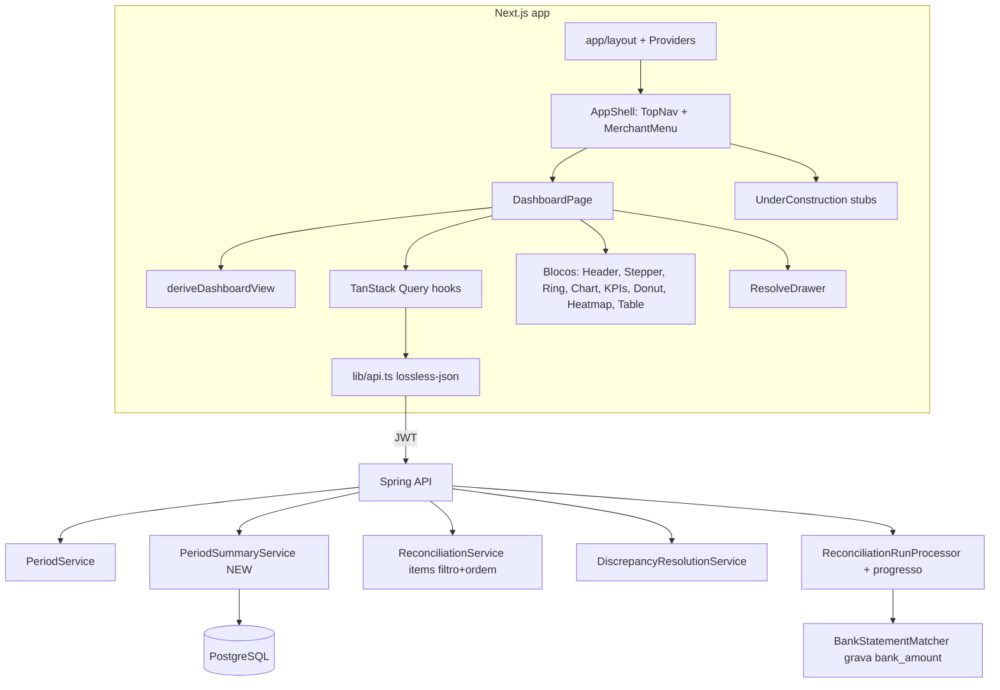

# Dashboard Redesign Design

**Spec**: `.specs/features/dashboard-redesign/spec.md`
**Context**: `.specs/features/dashboard-redesign/context.md`
**Visual reference**: `.specs/features/dashboard-redesign/design-reference.md`
**Status**: Approved

---

## Architecture Overview

O navegador continua falando direto com a API Spring com o JWT em memória (AD-007, mantido em AD-009). O TanStack Query passa a ser a camada de dados do frontend: cada bloco lê uma query com chave `[recurso, merchantId, fromDate, toDate]`, as mutações invalidam as chaves afetadas e o run é acompanhado por `refetchInterval`. O backend ganha um endpoint de resumo do período, um filtro/ordem nos items e o progresso do run. O dinheiro é somado só no servidor; o frontend formata strings decimais.



---

## Code Reuse Analysis

### Existing Components to Leverage

| Component | Location | How to Use |
| --- | --- | --- |
| `request`, `ApiError`, `getMerchants` | `frontend/lib/api.ts` | Base do cliente. `parse` com `lossless-json` mantém decimais como string; estende-se com os novos recursos |
| `formatAmount` | `frontend/components/dashboard.tsx` | Move para `lib/money.ts` e ganha variante sem `R$` e com sinal `−` |
| `AuthProvider` / `useAuth` | `frontend/lib/auth.tsx` | Sessão em memória e `signOut` no 401 |
| Páginas de login e cadastro | `frontend/app/login`, `frontend/app/register` | Ficam como estão; usam `auth.module.css`, que não depende do CSS do dashboard |
| `PeriodService.ensureWindow`, `currentCompleted` | `backend/.../reconciliation/service/PeriodService.java` | O resumo valida a janela e acha o run vigente com a mesma regra (400 e 404 iguais) |
| `ReconciliationItemSpecifications` | `backend/.../reconciliation/repository/ReconciliationItemSpecifications.java` | Ganha `discrepancyStatus`; os filtros de divergência passam a `EXISTS` |
| `ReconciliationRunStateService` | `backend/.../reconciliation/service/ReconciliationRunStateService.java` | Já escreve estado do run fora da transação do processor; recebe `recordTotal` e `recordProgress` |
| `BankStatementMatcher` | `backend/.../reconciliation/service/BankStatementMatcher.java` | Nos dois pontos de casamento (referência e data+valor) grava `bankAmount` e `bankMovementDate` no item |
| `MerchantAccessAspect` | `backend/.../security/MerchantAccessAspect.java` | O parâmetro `merchantId` cobre o endpoint novo sem checagem manual |
| Interfaces `*Api` | `backend/.../reconciliation/openapi/PeriodControllerApi.java` | AD-006: o resumo é documentado na interface |
| `AbstractIntegrationTest` | `backend/src/test/...` | Integração com Testcontainers para o resumo e os items |

### Integration Points

| System | Integration Method |
| --- | --- |
| Período | `GET /api/merchants/{id}/periods`, `POST .../periods/lock`, `POST .../periods/unlock` (existentes) |
| Resumo | `GET /api/merchants/{id}/periods/summary?fromDate&toDate` (novo) |
| Runs | `POST .../reconciliations`, `GET .../reconciliations` (lista), `GET .../reconciliations/{runId}` (polling) |
| Items | `GET .../reconciliations/{runId}/items?result&discrepancyType&discrepancyStatus&sort=absDifference,desc` (filtro e ordem novos) |
| Divergência | `GET`/`PATCH .../reconciliations/{runId}/discrepancies/{id}` (existentes) |
| Imports | `GET .../external-settlements/imports`, `GET .../bank-statements` (existentes, `size=1`) |
| Export | `GET .../reconciliations/{runId}/export` como blob com `Authorization` |
| PostgreSQL | Flyway `V23__dashboard_summary_support.sql` |
| Segurança | `SecurityConfig.java:31`: `PATH_PERIODS_NESTED` (`/api/merchants/*/periods/**`) já cobre `/periods/summary` |

---

## Components — Frontend

### Providers e layout raiz

- **Purpose**: fontes, tema e providers.
- **Location**: `frontend/app/layout.tsx`, `frontend/app/providers.tsx`
- **Interfaces**: `<Providers>{children}</Providers>` = `QueryClientProvider` + `AuthProvider`.
- **Details**: `next/font/local` carrega Inter, Inter Tight e IBM Plex Mono (arquivos latin dos pacotes `@fontsource`) como variáveis CSS. `globals.css` passa a conter só `@import 'tailwindcss'` + `@theme` de `design-reference.md`. `QueryClient` com `retry: false` para 4xx, `refetchOnWindowFocus: false`.

### AppShell (rotas autenticadas)

- **Purpose**: guarda de sessão, nav e seleção de empresa compartilhadas pelas rotas.
- **Location**: `frontend/app/(app)/layout.tsx`, `frontend/components/shell/`
- **Interfaces**:
  - `TopNav` — itens fixos, ativo por `usePathname`.
  - `MerchantMenu({ merchants, selectedId, onSelect })` — busca por nome ou CNPJ (dígitos), marca a atual, rodapé "Cadastrar empresa" → `/empresas`.
  - `useSelectedMerchant()` — contexto com `merchantId` e `select(id)`; primeiro da lista por padrão.
- **Reuses**: `getMerchants` (todas as páginas), `useAuth`.

### Rotas vazias

- **Location**: `frontend/app/(app)/{conciliacoes,divergencias,transacoes,importacoes,fechamento,empresas}/page.tsx`
- **Interfaces**: `UnderConstruction({ title })` — nenhum request.

### DashboardPage

- **Purpose**: orquestra janela, queries, estado da tela e ações.
- **Location**: `frontend/app/(app)/page.tsx`, `frontend/components/dashboard/`
- **Interfaces**:
  - `useDashboardWindow(merchantId)` — janela inicial: a do run mais recente (`GET reconciliations?size=1&sort=createdAt,desc`); sem run, o mês civil atual. Troca de empresa reseta a janela.
  - `deriveDashboardView(input): DashboardView` — função pura que decide `loading | noMerchant | forbidden | empty | running | failed | locked | open` a partir das queries. Testável sem DOM.
- **Dependencies**: hooks de `lib/queries.ts`.

### Hooks de dados

- **Location**: `frontend/lib/queries.ts`
- **Interfaces**:
  - `useRuns(merchantId)`, `useLatestRun(merchantId, window)` — o último run da janela; `refetchInterval: 3000` enquanto `PENDING`/`RUNNING`.
  - `usePeriod(merchantId, window)` — `placeholderData: keepPreviousData` (durante o run, `/periods` responde 409 e o dashboard mostra os dados anteriores esmaecidos).
  - `usePeriodSummary(merchantId, window)` — resumo novo.
  - `useOpenDiscrepancies(runId, type?)` — items `discrepancyStatus=OPEN`, `sort=absDifference,desc`, `size=4`.
  - `useDiscrepancy(runId, discrepancyId)` — detalhe com histórico.
  - `useLatestImports(merchantId)` — último import de liquidação e de extrato.
  - Mutações: `useResolveDiscrepancy`, `useRunReconciliation`, `useLockPeriod`, `useUnlockPeriod`, `useExportRun`. Sucesso invalida `period`, `summary`, `openDiscrepancies`, `discrepancy`, `runs` da mesma chave.
- **Details**: chaves incluem `merchantId` e a janela, então respostas de outra empresa nunca chegam ao bloco atual (edge case da spec). Um `onError` global faz `signOut` + `/login` no 401.

### Blocos visuais

- **Location**: `frontend/components/dashboard/*.tsx`
- **Interfaces** (todos recebem dados já buscados e um `state` de bloco `ready | loading | error`):
  - `PageHeader({ view, window, onRun, onExport })`, `PeriodMenu({ window, runs, locks, onApply })`
  - `CloseStepper({ imports, run, openCount, locked, onLock, onUnlock })`
  - `MatchRingCard({ period, summary, run })`, `KpiCards({ period, summary })`
  - `CashflowChart({ days })`, `TypeDonut({ openByType })`, `DailyHeatmap({ days, window })`
  - `OpenDiscrepancyTable({ items, typeFilter, onFilter, onResolve })`
  - `ResolveDrawer({ runId, discrepancyId, list, locked, onClose, onNavigate })`
  - Estados: `DashboardSkeleton`, `NoMerchant`, `EmptyOnboarding`, `RunFailedCard`, `NetworkBanner`, `BlockError`.

### Geometria e formatação puras

- **Location**: `frontend/lib/charts.ts`, `frontend/lib/money.ts`, `frontend/lib/period.ts`
- **Interfaces**:
  - `ringDash(rate: string, circumference: number): string`
  - `seriesPath(values: string[], max: number, w: number, h: number): string`, `gapPolygon(expected, received, max, w, h): string`
  - `donutSegments(counts: Record<string, number>, r: number, gap: number)`
  - `heatBand(matched: number, total: number): 'full' | 'soft' | 'neutral' | 'warn' | 'bad' | 'empty'`
  - `formatMoney(value: string, opts?: { currency?: boolean; signed?: boolean }): string`
  - `subtractDecimal(a: string | null, b: string | null): string` — em centavos com `BigInt`, para "Usar diferença".
  - `monthWindow(date): Window`, `monthsBack(from, to): Window[]`, `formatWindow(window)`
- **Details**: valores entram como string e só viram número para escala de gráfico (perda de precisão aceitável em pixels, nunca em texto).

---

## Components — Backend

### Migration V23

- **Location**: `backend/src/main/resources/db/migration/V23__dashboard_summary_support.sql`
- **Changes**:
  - `reconciliation_items.bank_amount NUMERIC(19,2) NULL`, `reconciliation_items.bank_movement_date DATE NULL`
  - `reconciliation_runs.bank_tracked BOOLEAN NOT NULL DEFAULT FALSE` (runs antigos: resumo devolve campos de banco nulos)
  - `reconciliation_runs.processed_items INTEGER NULL`

### BankStatementMatcher (alteração)

- **Purpose**: registrar no item o crédito casado.
- **Interfaces**: sem mudança de assinatura. Ao ligar linha e liquidação, `item.setBankAmount(line.getAmount())` e `item.setBankMovementDate(line.getMovementDate())`. O processor marca `run.bankTracked = true`.

### PeriodSummaryService (novo)

- **Location**: `backend/.../reconciliation/service/PeriodSummaryService.java`
- **Interfaces**: `PeriodSummaryResponseDTO summarize(UUID merchantId, LocalDate fromDate, LocalDate toDate)`
- **Rules**:
  - Janela e run vigente pela mesma regra de `PeriodService` (400 janela inválida, 404 sem run vigente, 409 com run em andamento).
  - Totais e série diária por agregação JPQL em `IReconciliationItemRepository` (agrupando por `transactionDate`; items sem `transactionDate`, ou seja liquidação órfã, ficam fora da série e dos totais de venda).
  - `feeAmount = Σ(transactionAmount − expectedNetAmount)`; `feeAboveContractAmount = Σ max(0, expectedNetAmount − settlementNetAmount)` dos items com `FEE_DIVERGENCE`.
  - `openByType` por `IReconciliationDiscrepancyRepository` (status `OPEN`, run vigente).
  - `previousRunMatchRate`: run `COMPLETED` substituído mais recente da mesma janela, ou null.
  - `previousWindowGrossAmount`: janela anterior de mesmo tamanho (`fromDate − n` a `fromDate − 1`) com run vigente, ou null.
  - Banco (`bankReceivedAmount`, `days[].bankReceived`) nulo quando `run.bankTracked = false`.
- **Reuses**: `ReconciliationProperties`, regra de janela de `PeriodService` (extrair para um helper compartilhado `PeriodWindowPolicy`).

### PeriodController / PeriodControllerApi (alteração)

- `GET /periods/summary` com `fromDate`, `toDate` obrigatórios. Documentação em português com exemplo e 200/400/401/403/404/409.

### Items: filtro e ordem

- `ReconciliationItemSpecifications.withFilters(runId, result, discrepancyType, discrepancyStatus)` usa subquery `EXISTS` para tipo e status (sem `join` + `distinct`, que quebra o `ORDER BY` por expressão no PostgreSQL).
- `ReconciliationService.findItems` reconhece a propriedade de ordenação `absDifference` e aplica `ORDER BY abs(coalesce(settlementNetAmount,0) − coalesce(expectedNetAmount,0))` + `externalReference` como desempate; outras propriedades seguem o `Pageable`.
- `discrepancyStatus` inválido cai no 400 `VALIDATION_ERROR` que o handler já dá para enum inválido.

### Progresso do run

- `ReconciliationRunStateService.recordTotal(runId, total)` e `recordProgress(runId, processed)` em `REQUIRES_NEW`, por `UPDATE` JPQL (sem carregar a entidade).
- `ReconciliationRunProcessor`: após o engine e o matcher, `recordTotal`; após cada lote de `persistInBatches`, `recordProgress`. O `save` final grava `processedItems = totalItems`.
- `ReconciliationRunResponseDTO` ganha `processedItems`.

---

## Data Models

### PeriodSummaryResponseDTO (backend → frontend)

```typescript
interface PeriodSummary {
  runId: string
  fromDate: string            // ISO date
  toDate: string
  grossAmount: string         // decimais como string no frontend (lossless-json)
  expectedNetAmount: string
  feeAmount: string
  feeAboveContractAmount: string
  bankReceivedAmount: string | null
  openByType: Partial<Record<DiscrepancyType, number>>
  days: Array<{
    date: string
    expectedNetAmount: string
    settledNetAmount: string
    bankReceivedAmount: string | null
    itemCount: number
    matchedCount: number
  }>                          // um registro por data da janela, inclusive dias sem item (contagens 0)
  previousRunMatchRate: string | null
  previousWindowGrossAmount: string | null
}
```

### Run (acréscimo)

```typescript
interface Run {
  // campos existentes de ReconciliationRunResponseDTO
  processedItems: number | null
}
```

### Estado de tela (frontend)

```typescript
type DashboardView =
  | { kind: 'loading' }
  | { kind: 'noMerchant' }
  | { kind: 'forbidden' }
  | { kind: 'empty'; window: Window }
  | { kind: 'running'; run: Run; previous?: Loaded }
  | { kind: 'failed'; run: Run; previous?: Loaded }
  | { kind: 'open'; data: Loaded }
  | { kind: 'locked'; data: Loaded }
```

---

## Error Handling Strategy

| Error Scenario | Handling | User Impact |
| --- | --- | --- |
| Falha de rede (fetch rejeita) | `ApiError` sem status; banner global; queries mantêm dados anteriores | Banner "Não foi possível conectar à API" + "Tentar de novo" (refetch de tudo) |
| 401 | `onError` global: `signOut` + `router.replace('/login')` | Volta ao login |
| 403 | View `forbidden` | "Você não tem acesso a esta empresa" + menu de empresa |
| 404 em `/periods` ou `/summary` | View `empty` | Onboarding de três passos |
| 409 em `/periods` durante run | Ignorado se o run da janela está em andamento; mantém dados anteriores | Estado "run em andamento" |
| 409 no PATCH | Toast + refetch do detalhe | "Esta divergência mudou. Recarregamos o estado atual." |
| 409 no POST do run | Mensagem da API + começa polling do run existente | Estado de run em andamento |
| 409 em lock/unlock | Mensagem da API + refetch do período | Régua volta ao estado real |
| 400 na janela personalizada | Mantém a janela anterior | Mensagem da API sob os campos De/Até |
| Erro em um bloco | `BlockError` só naquele bloco | "Recarregar" refaz aquela query |
| Run `FAILED` | Polling para | Card "Falhou" com `errorMessage`, id e "Rodar de novo" |

---

## Risks & Concerns

| Concern | Location (file:line) | Impact | Mitigation |
| --- | --- | --- | --- |
| `GET /periods` responde 409 com run em andamento | `backend/.../service/PeriodService.java:57` (`rejectInFlight`) | O dashboard ficaria vazio durante cada run | `keepPreviousData` + view `running` decidida pela query do run, não pelo período |
| O processor grava tudo numa transação; progresso não seria visível | `backend/.../service/ReconciliationRunProcessor.java:65-120` | Progresso sempre nulo até o fim | `REQUIRES_NEW` por `UPDATE` JPQL; `save` final fixa `processedItems = totalItems` para não ser sobrescrito pela entidade em memória |
| Filtro por tipo usa `join` + `distinct` | `backend/.../repository/ReconciliationItemSpecifications.java:35` | `ORDER BY abs(...)` com `DISTINCT` falha no PostgreSQL | Trocar por `EXISTS`; teste de integração cobre filtro + ordem juntos |
| Casamento com o extrato não é persistido | `backend/.../service/BankStatementMatcher.java` | Resumo não saberia o valor recebido | Colunas novas em V23; runs antigos com `bankTracked=false` devolvem banco nulo |
| `next/font/google` baixa fontes no build | `frontend/app/layout.tsx` | Build falha quando o Google Fonts responde diferente (ocorreu na CI do PR) | Resolvido: `next/font/local` com arquivos `@fontsource` fixados no lockfile; o build não usa rede |
| Testes atuais renderizam com `renderToStaticMarkup` em ambiente node | `frontend/components/dashboard.test.ts:3` | Interações (gaveta, teclado, menus) ficam sem teste | Adicionar `jsdom`, `@testing-library/react` e `@testing-library/user-event` como devDependencies |
| `dashboard.tsx` e `app/page.tsx` são removidos | `frontend/components/dashboard.tsx`, `frontend/app/page.tsx` | Testes existentes quebram | Os testes de formatação migram para `lib/money.test.ts`; os de estado vazio viram testes de `deriveDashboardView` |
| Volume do resumo em janelas longas | agregação por dia | Janela de 366 dias = 366 registros | Aceitável; agregação é SQL, não carrega items |

---

## Tech Decisions

| Decision | Choice | Rationale |
| --- | --- | --- |
| Camada de dados do frontend | TanStack Query v5 | Escolha do usuário; polling, invalidação e chave por empresa/janela |
| Gráficos | SVG à mão com funções puras de geometria | Escolha do usuário; testável sem DOM |
| Testes de interação | Vitest + jsdom + Testing Library | Gaveta, menus e teclado precisam de eventos |
| Fontes | `next/font/local` + `@fontsource` | Sem arquivos binários no repo e sem rede no build; versões fixadas no lockfile |
| Valor do banco por item | Colunas em `reconciliation_items` + `bank_tracked` no run | Escolha do usuário; resumo por SQL |
| Ordem por diferença | Propriedade de ordenação virtual `absDifference` | Mantém o contrato paginado existente |
| Rotas | Grupo `app/(app)` com layout autenticado | Shell compartilhado entre dashboard e stubs sem afetar `/login` |

**Project-level decision:** AD-009 (registrada em `.specs/STATE.md`) substitui AD-007.
