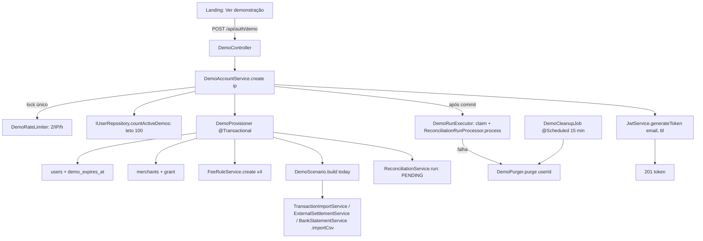

# Demonstração por Visitante Design

**Spec**: `.specs/features/demo-account/spec.md`
**Status**: Approved

---

## Approach

Duas formas de gerar o cenário pelos serviços do domínio:

| | A. CSV em memória pelos serviços de importação (escolhida) | B. Entidades direto pelos repositórios |
| --- | --- | --- |
| Como | O cenário monta os três CSVs (transações, liquidações, extrato) como texto e chama `importCsv` de cada serviço, como o visitante faria | O cenário cria `InternalTransactionEntity`, `ExternalSettlementEntity` etc. e salva pelos repositórios |
| A favor | Passa pelos parsers, pelo cálculo do líquido esperado (`ExpectedNetAmountCalculator`), pela checagem de período e pela auditoria. Os lotes aparecem em Importações | Mais rápido de escrever no começo |
| Contra | Precisa de um `MultipartFile` em memória no código de produção | Duplica regra de negócio (líquido esperado, vínculo com lote) e pode gerar um estado que o sistema real não gera |

A conciliação usa o mesmo processador da fila, mas roda **na requisição**, depois do commit do cenário (ver "Por que dois passos").

---

## Architecture Overview



### Por que dois passos

`ReconciliationRunStateService` e `ReconciliationRunProcessor.process` abrem transações próprias (`REQUIRES_NEW`). Dentro de uma transação única com o cenário, eles não enxergariam as transações ainda não commitadas. Por isso:

1. `DemoProvisioner` grava usuário, merchant, taxas, importações e o run `PENDING` numa transação e faz commit.
2. `DemoRunExecutor` reserva o run (`tryMarkRunning`) e chama `process` na mesma thread. Se o `ReconciliationRunDispatcher` reservou antes (ele varre a cada 1 s), o executor espera o run chegar a `COMPLETED` ou `FAILED`, consultando a cada 200 ms, até 30 s.
3. Se o run termina `FAILED`, estoura o tempo ou qualquer passo lança exceção, `DemoPurger.purge(userId)` apaga tudo da demo e a API responde `500`. Isso cumpre DEMO-01 AC10 por compensação.

---

## Code Reuse Analysis

### Existing Components to Leverage

| Component | Location | How to Use |
| --- | --- | --- |
| `TransactionImportService.importCsv` | `backend/.../transaction/service/` | Importa o CSV de transações do cenário |
| `ExternalSettlementService.importCsv(merchantId, file, layout)` | `backend/.../externalsettlement/service/` | Importa liquidações no layout `RECONPAY` |
| `BankStatementService.importCsv` | `backend/.../bankstatement/service/` | Importa o extrato |
| `FeeRuleService.create` | `backend/.../feerule/service/` | Cria as 4 regras de taxa |
| `ReconciliationService.run` | `backend/.../reconciliation/service/` | Cria o run `PENDING` de uma janela de 60 dias |
| `ReconciliationRunStateService.tryMarkRunning` + `ReconciliationRunProcessor.process` | idem | Execução síncrona do run, igual à do worker |
| `UserMerchantAccessService.grantIfAbsent` | `backend/.../auth/service/` | Concede o merchant da demo ao usuário |
| `CnpjRules` | `backend/.../shared/CnpjRules.java` | Ganha `generate(RandomGenerator)`, reaproveitando `checkDigit` |
| `JwtService` | `backend/.../security/JwtService.java` | Ganha `generateToken(email, Duration ttl)` |
| `UserDetailsServiceImpl` | `backend/.../security/` | Recusa demo expirada; o filtro JWT já transforma isso em `401` |
| `AuditLogger` | `backend/.../observability/` | `DEMO_CREATED`, `DEMO_PURGED` |
| `Clock` (`TimeConfig`, UTC) | `backend/.../config/TimeConfig.java` | Expiração, janela por IP e datas do cenário, testáveis com relógio fixo |
| `GlobalExceptionHandler` + `StandardError` | `backend/.../exception/handler/` | `429`, `503` e `403` de cota |
| `AuthProvider` / `authenticate` | `frontend/lib/auth.tsx`, `frontend/lib/api.ts` | `startDemo` segue o formato de `signIn`; `createDemo` busca `/api/me` como `authenticate` |
| Botões do herói e do CTA final | `frontend/components/landing/LandingPage.tsx`, `FinalCta.tsx` | Mesmo estilo (`primaryButton`), agora `<button>` em `DemoButton` |

### Integration Points

| System | Integration Method |
| --- | --- |
| Spring Security | `POST /api/auth/demo` entra no `permitAll` de `SecurityConfig` |
| Tomcat `RemoteIpValve` | `server.forward-headers-strategy: native` em `application-prod.yaml`; o IP do visitante é `request.getRemoteAddr()` |
| Flyway | `V25__demo_accounts.sql` |
| Swagger | `DemoControllerApi` com `201`, `429`, `503`; `ApiDocsIntegrationTest` cobre |
| Agendamento | `@EnableScheduling` já existe em `AsyncConfig` |

---

## Components

### `V25__demo_accounts.sql`

- `ALTER TABLE users ADD COLUMN demo_expires_at TIMESTAMPTZ NULL;`
- `ALTER TABLE users ADD COLUMN demo_import_count INTEGER NOT NULL DEFAULT 0;`
- `CREATE INDEX idx_users_demo_expires_at ON users (demo_expires_at) WHERE demo_expires_at IS NOT NULL;`

### `DemoProperties`

- **Location**: `backend/.../demo/config/DemoProperties.java`, prefixo `reconpay.demo`
- **Fields**: `ttl` (`24h`), `maxActive` (100), `perIpPerHour` (2), `maxMerchants` (2), `maxImports` (10), `cleanupDelayMs` (900000), `runWaitTimeout` (`30s`)

### `DemoController` + `DemoControllerApi`

- **Location**: `backend/.../demo/controller/`, `backend/.../demo/openapi/`
- **Interface**: `POST /api/auth/demo` → `201 AuthResponseDTO`. Passa `request.getRemoteAddr()` ao serviço.

### `DemoAccountService`

- **Purpose**: orquestrar a criação sob um lock único.
- **Interface**: `AuthResponseDTO create(String clientIp)`
- **Flow** (dentro de um `ReentrantLock` justo; DEMO-04 AC8):
  1. `rateLimiter.isAllowed(ip)` senão `DemoRateLimitException` (`429`).
  2. `userRepository.countByDemoExpiresAtAfter(now) >= maxActive` → `DemoUnavailableException` (`503`).
  3. `provisioner.provision(now)` → `DemoAccount(userId, email, runId)`.
  4. `runExecutor.complete(runId)`; em exceção, `purger.purge(userId)` e relança como `500`.
  5. `rateLimiter.record(ip)` (só sucesso conta; DEMO-03 AC5).
  6. `jwtService.generateToken(email, min(jwt.expiration, ttl))`.
- **Dependencies**: `DemoRateLimiter`, `IUserRepository`, `DemoProvisioner`, `DemoRunExecutor`, `DemoPurger`, `JwtService`, `DemoProperties`, `Clock`, `AuditLogger`

### `DemoRateLimiter`

- **Purpose**: janela deslizante de 60 min por IP, em memória.
- **Interface**: `boolean isAllowed(String ip)`, `void record(String ip)`
- **Notes**: `Map<String, Deque<Instant>>` com `Clock`; descarta instantes fora da janela a cada chamada e remove IPs vazios. Só é chamado dentro do lock do serviço, então não precisa de sincronização própria.

### `DemoProvisioner`

- **Purpose**: gravar usuário e cenário numa transação.
- **Interface**: `@Transactional DemoAccount provision(Instant now)`
- **Flow**: usuário (`name` "Visitante", e-mail `demo-<12 hex>@demo.reconpay.invalid`, senha aleatória de 32 bytes codificada com o `PasswordEncoder`, `OPERATOR`, `active=true`, `demoExpiresAt=now+ttl`) → merchant "Loja Demonstração" com CNPJ de `CnpjRules.generate` repetido até não existir → `grantIfAbsent` → 4 `FeeRuleService.create` → 3 `importCsv` com `InMemoryCsvFile` → `ReconciliationService.run(merchantId, [today-60, today-1])`.
- **Notes**: grava o merchant pelo repositório, não por `MerchantService.create`, que exige um usuário autenticado (a criação é anônima). Sem usuário autenticado, as importações do cenário não passam pela cota (DEMO-05 AC3).

### `DemoScenario`

- **Purpose**: o cenário fixo como dados puros.
- **Interface**: `static DemoScenario build(LocalDate today)` → `feeRules()`, `transactionsCsv()`, `settlementsCsv()`, `bankStatementCsv()`
- **Notes**:
  - Determinístico: sem aleatoriedade. As referências são `DEMO-0001…`, e valores e meios seguem uma tabela fixa que se repete pelos dias.
  - Datas de `today-60` a `today-1`; as liquidações caem até `today-1` (o `today` em UTC do `Clock`).
  - Cerca de 200 transações. Algumas linhas fixas provocam cada divergência de DEMO-01 AC8: transação sem liquidação, liquidação sem transação, valor bruto diferente, líquido diferente do esperado, liquidação sem crédito no extrato.
  - Testado puro: as datas ficam na janela, as referências são únicas e os totais são os mesmos para o mesmo `today`.

### `InMemoryCsvFile`

- **Purpose**: `MultipartFile` imutável sobre um `byte[]` UTF-8, para chamar os `importCsv`.
- **Location**: `backend/.../demo/service/InMemoryCsvFile.java`

### `DemoRunExecutor`

- **Interface**: `void complete(UUID runId)`
- **Flow**: `tryMarkRunning`; se reservou, `processor.process(runId)` e, em exceção, `state.markFailed` e relança. Se não reservou, consulta o status a cada 200 ms até `COMPLETED` (retorna), `FAILED` (lança) ou `runWaitTimeout` (lança).

### `DemoPurger`

- **Purpose**: apagar uma demo e os merchants só dela.
- **Interface**: `@Transactional void purge(UUID userId)`; `@Transactional List<UUID> findExpired(Instant now)`
- **Flow**:
  - Merchants do usuário em que todo outro usuário com acesso é uma demo já expirada (DEMO-06 AC3–AC4). O próprio usuário apagado não entra na conta: na compensação da criação ele ainda não expirou, e o merchant dele é apagado. Um merchant que uma conta comum ou outra demo ativa alcança fica.
  - Para esses merchants, DELETE nativo em ordem de FK:
    `discrepancy_transitions` → `discrepancy_adjustments` → `reconciliation_discrepancies` → `period_locks` → `reconciliation_items` → `reconciliation_runs` → `bank_statement_lines` → `bank_statement_imports` → `external_settlements` → `settlement_imports` → `internal_transactions` → `transaction_imports` → `fee_rules` → `merchants` (`user_merchants` cai por cascade).
  - Depois apaga o usuário (`email_verification_tokens` e os acessos restantes caem por cascade).
- **Notes**: um merchant com acesso de conta comum fica; o acesso da demo cai junto com o usuário (DEMO-06 AC4).

### `DemoCleanupJob`

- **Interface**: `@Scheduled(fixedDelayString = "${reconpay.demo.cleanup-delay-ms:900000}") void purgeExpired()`
- **Flow**: `findExpired(now)` e `purge` de cada um numa transação própria. Uma falha numa demo vira `log.warn` e não para as outras. No fim, um `log.info` com os usuários e merchants apagados (DEMO-06 AC7).

### `DemoQuotaGuard`

- **Purpose**: cotas por conta de demo (DEMO-05).
- **Interface**: `void checkMerchantCreation()`, `void consumeImport()`
- **Flow**:
  - Sem usuário autenticado, ou com usuário que não é demo, não faz nada.
  - Senão, lê o usuário com `PESSIMISTIC_WRITE` (serializa pedidos simultâneos da mesma demo).
  - Merchants: `count(user_merchants do usuário) >= maxMerchants` → `DemoQuotaExceededException("A demonstração permite no máximo 2 empresas.")`.
  - Importações: `demo_import_count >= maxImports` → exceção com "…10 importações."; senão incrementa.
- **Call sites**: início de `MerchantService.create` e dos três `importCsv`, dentro da transação de cada um. Uma importação recusada por erro de CSV desfaz o incremento.
- **Reuses**: `AuthenticatedUserAccessor` ganha `Optional<CustomUserDetails> currentPrincipal()`.

### Expiração no login por token

- `UserDetailsServiceImpl.loadUserByUsername` lança `UsernameNotFoundException` quando `demoExpiresAt != null && !demoExpiresAt.isAfter(clock.instant())`. O `JwtAuthenticationFilter` já trata isso como não autenticado → `401` (DEMO-06 AC1).

### `MeResponseDTO.demoExpiresAt`

- Campo `Instant demoExpiresAt`, nulo para conta comum (DEMO-09 AC1–2).

### Frontend

| Peça | Local | O que faz |
| --- | --- | --- |
| `createDemo()` | `frontend/lib/api.ts` | `POST /api/auth/demo` e depois `GET /api/me`; devolve `{ token, user }` |
| `Me.demoExpiresAt` | `frontend/lib/api.ts` | `string \| null` |
| `AuthProvider` | `frontend/lib/auth.tsx` | `startDemo()` grava o token em `sessionStorage` (`reconpay.demoToken`). Ao montar, restaura: lê o token, chama `/api/me`; `401` apaga o token e marca `expired`. Expõe `restoring`. `signOut` apaga o token. `signIn` nunca grava |
| `AppShell` | `frontend/components/shell/AppShell.tsx` | Enquanto `restoring`, mostra "Abrindo sessão..."; depois, sem token, vai para `/login`, ou para `/` se a sessão de demo expirou na restauração (DEMO-08 AC5) |
| `DemoButton` | `frontend/components/landing/DemoButton.tsx` | `<button>` com o estilo do CTA. Durante o pedido, fica desabilitado e mostra "Preparando demonstração..."; erro em `role="alert"` abaixo; sucesso → `router.push('/painel')`. Usado no herói e no `FinalCta` |
| `DemoBanner` | `frontend/components/shell/DemoBanner.tsx` | "Conta de demonstração · expira às HH:mm" (`Intl.DateTimeFormat` local) quando `user.demoExpiresAt` existe; montado no topo do `AppShell` |

`sessionStorage` é acessado só em `useEffect` e dentro de `try/catch` (SSR e navegação privada).

---

## Data Models

```sql
-- users (V25)
demo_expires_at   TIMESTAMPTZ NULL      -- não nulo = conta de demo
demo_import_count INTEGER NOT NULL DEFAULT 0
```

```java
record DemoAccount(UUID userId, String email, UUID runId) {}
```

---

## Error Handling Strategy

| Error Scenario | Handling | User Impact |
| --- | --- | --- |
| IP com 2 demos na última hora | `DemoRateLimitException` → `429 TOO_MANY_REQUESTS` | Mensagem junto ao botão |
| 100 demos ativas | `DemoUnavailableException` → `503 SERVICE_UNAVAILABLE` | Mensagem junto ao botão |
| Falha ao gerar cenário ou conciliar | Transação do provisionamento desfeita, ou `DemoPurger.purge` na compensação; `500` | "Não foi possível abrir a demonstração. Tente novamente." |
| Cota de merchants ou importações | `DemoQuotaExceededException` → `403 FORBIDDEN` | As telas existentes já mostram a `message` da API |
| Token de demo expirado | `UserDetailsServiceImpl` recusa → `401` | Sessão encerrada; na restauração, volta à landing |
| Falha na limpeza de uma demo | `log.warn` com `userId`; segue para a próxima | Nenhum; tenta de novo em 15 min |

---

## Risks & Concerns

| Concern | Location (file:line) | Impact | Mitigation |
| --- | --- | --- | --- |
| Tabela nova ligada a merchant sem entrar no `DemoPurger` | `backend/src/main/resources/db/migration/` | A limpeza falha por FK, ou deixa dados órfãos | Teste de integração que lê `information_schema` e exige que toda tabela com FK para `merchants`, ou para uma tabela já na lista, esteja na lista do `DemoPurger` |
| `discrepancy_adjustments.created_by` e `discrepancy_transitions.actor_user_id` apontam para `users` sem cascade | `V20__discrepancy_resolution.sql:11`, `:24` | Uma demo que resolveu divergência num merchant compartilhado não pode ser apagada | Caso só ocorre se um ADMIN conceder merchant real a uma demo; a limpeza registra `warn` e mantém o usuário expirado (já sem acesso por `401`) |
| Dispatcher pode reservar o run da demo antes do executor | `reconciliation/service/ReconciliationRunDispatcher.java:45` | Duas threads no mesmo run | `tryMarkRunning` é atômico (`claimPending`); quem perde só espera o status |
| Fila do executor cheia não afeta a demo | `config/AsyncConfig.java:31` | — | A demo processa na própria thread, fora do pool |
| `MerchantService.create` exige usuário autenticado | `merchant/service/MerchantService.java:52` | O provisionamento é anônimo | O provisionador grava pelo repositório e concede com `grantIfAbsent` |
| Auditoria do cenário sem ator | `observability/AuditLogger.java:58` | Eventos do cenário aparecem como anônimos | Aceito; `DEMO_CREATED` registra o `userId` da demo |
| Lock único em memória | `DemoAccountService` | Não serializa entre instâncias | Instância única (AGENTS.md); o teto no banco segue sendo checado |
| IP real depende do Docker | VPS: nginx → `127.0.0.1:8080` → container | Se a conexão chegar ao container com IP fora das faixas internas, o `X-Forwarded-For` é ignorado e todos dividem um IP | O Docker entrega pela rede bridge (172.16/12, faixa interna padrão do `RemoteIpValve`); conferência manual depois do deploy: a 3ª demo da mesma rede recebe `429` e outra rede ainda cria |
| `ReconciliationService.run` sem verificação de acesso | `reconciliation/service/ReconciliationService.java:67` | — | O acesso é checado no controller pelo `MerchantAccessAspect`; o provisionador chama o serviço direto, sem passar pelo aspecto |

---

## Tech Decisions

| Decision | Choice | Rationale |
| --- | --- | --- |
| Módulo | Pacote novo `br.com.hanrry.reconpay.demo`; o AGENTS.md ganha `demo` na lista de módulos | A feature cruza auth, merchant, importações e conciliação |
| Gerar o cenário | CSV em memória pelos `importCsv` (abordagem A) | Mesmas regras que o visitante usa |
| Conciliação | Síncrona, depois do commit, com compensação | O processador usa `REQUIRES_NEW`; o `201` sai com o painel pronto |
| Cota de importações | Contador `demo_import_count` com lock do usuário | As tabelas de lote não guardam quem importou; o contador é exato e desfaz junto com a transação |
| IP real | `RemoteIpValve` do Tomcat (`forward-headers-strategy: native`) | Usa o endereço mais à direita que não é proxy interno (DEMO-03 AC6) sem código próprio |
| Relógio | Tudo pelo `Clock` UTC | Testes com relógio fixo; "hoje" do cenário em UTC |

**Project-level decisions** (registradas em `.specs/STATE.md`):

- **AD-013**: conta de demonstração é um `OPERATOR` com `demo_expires_at` (atributo, não papel), com cotas e limpeza agendada.
- **AD-014**: exceção ao AD-009: o token de **demo** fica em `sessionStorage`; o login comum continua só em memória.
