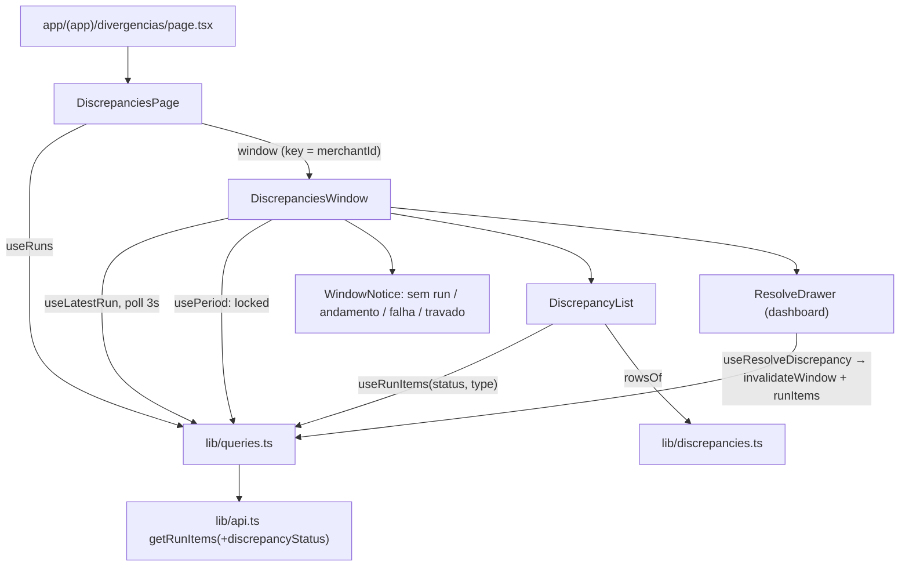

# Tela de Divergências Design

**Spec**: `.specs/features/discrepancies-screen/spec.md`
**Status**: Approved

---

## Architecture Overview

Só frontend, sem endpoint novo. A tela monta a mesma cadeia de dados do dashboard: `useRuns` para a janela inicial e o menu, `useLatestRun` para o run vigente com polling e `usePeriod` para o travamento. Por cima dela, uma lista paginada dos itens do run, filtrada por status e tipo de divergência. Resolver e reabrir usam a `ResolveDrawer` do dashboard. Três peças existentes ganham extensões compatíveis:
- o filtro `discrepancyStatus` em `getRunItems`;
- a chave de `runItems` com status e a invalidação de `runItems` depois de resolver;
- um rodapé configurável na gaveta.

---

## Code Reuse Analysis

### Existing Components to Leverage

| Component | Location | How to Use |
| --- | --- | --- |
| `ResolveDrawer`, `DrawerEntry` | `frontend/components/dashboard/ResolveDrawer.tsx` | Gaveta inteira: lados da transação, histórico, aceitar/ajustar/baixar, reabrir, modo `locked`, J/K; ganha `footerNoun` opcional |
| `PeriodMenu`, `windowKey` | `frontend/components/dashboard/PeriodMenu.tsx` | Menu com runs e travamentos, como no dashboard |
| Janela inicial e mapa de travamentos | `frontend/components/dashboard/DashboardPage.tsx:62-64,189-192` | Mesma regra: run mais recente ou mês atual; `locks` do cache de `period` |
| `useRuns`, `useLatestRun`, `usePeriod`, `useResolveDiscrepancy`, `invalidateWindow`, `inFlight` | `frontend/lib/queries.ts` | Dados da janela e resolução |
| `getRunItems`, `RunItemFilters`, `useRunItems`, `queryKeys.runItems` | `frontend/lib/api.ts`, `frontend/lib/queries.ts` | Lista paginada; ganham `discrepancyStatus` |
| `rowDiscrepancy`, `methodLine` (padrão) | `frontend/components/dashboard/OpenDiscrepancyTable.tsx` | Mesma apresentação da coluna Transação |
| `TYPE_LABELS`, `STATUS_LABELS`, `METHOD_LABELS` | `frontend/components/dashboard/format.ts` | Rótulos |
| `formatMoney`, `formatTransactionDate`, `monthWindow` | `lib/money.ts`, `lib/transactions.ts`, `lib/period.ts` | Formatos |
| `NoMerchant`, `BlockError` | `components/dashboard/states.tsx` | Sem empresa e erro |
| Tabela, paginação, selects | `components/reconciliations/RunItems.tsx` | Mesma marcação |
| Servidor em memória e troca de empresa nos testes | `components/reconciliations/ReconciliationsPage.test.tsx`, `components/dashboard/DashboardPage.test.tsx` | Mesmo estilo |

### Integration Points

| System | Integration Method |
| --- | --- |
| `GET /reconciliations?…&fromDate&toDate` (via `useLatestRun`) | Run vigente da janela |
| `GET /periods?fromDate&toDate` (via `usePeriod`) | `locked` da janela |
| `GET /reconciliations/{runId}/items?…[&result=DIVERGENT][&discrepancyStatus][&discrepancyType]` | Lista |
| `GET`/`PATCH /reconciliations/{runId}/discrepancies/{id}` (pela gaveta) | Detalhe, resolver, reabrir |

---

## Components

### `ResolveDrawer` (prop opcional)

- **Change**: `footerNoun?: string | null`, com padrão `'abertas'`. O rodapé fica "`<posição> de <total> <footerNoun> · J / K navega`"; com `null`, sai sem o substantivo. O dashboard não passa a prop e continua igual.

### Cliente da API (`lib/api.ts`)

- **Change**: `RunItemFilters` ganha `discrepancyStatus?: DiscrepancyStatus`. `getRunItems` acrescenta `&discrepancyStatus=<status>` no fim, só quando informado. As URLs atuais (`result`, `discrepancyType`) não mudam.

### Hooks (`lib/queries.ts`)

- **Change**:
  - `queryKeys.runItems` inclui `discrepancyStatus` ('ALL' quando ausente) na chave completa.
  - `queryKeys.runItems(merchantId)`, só com a empresa, devolve o prefixo `['runItems', merchantId]`.
  - `invalidateWindow` também invalida `['runItems', merchantId]`, para a lista recarregar depois de resolver ou reabrir. Em `/conciliacoes/[runId]` isso não muda nada visível; os itens só ficam mais frescos.

### Regras (`lib/discrepancies.ts`)

- `STATUS_FILTERS`: `[{ value: 'OPEN', label: 'Abertas' }, { 'ACCEPTED', 'Aceitas' }, { 'ADJUSTED', 'Ajustadas' }, { 'WRITTEN_OFF', 'Baixadas' }, { 'ALL', 'Todas' }]`
- `itemFilters(status, type): RunItemFilters`. `ALL` vira `{ result: 'DIVERGENT' }`; um status vira `{ discrepancyStatus }`. O tipo vira `discrepancyType`.
- `rowsOf(items, status, type): DrawerEntry[]`: uma entrada por divergência que atende aos filtros, na ordem dos itens e das divergências.

### `WindowNotice`

- **Location**: `frontend/components/discrepancies/WindowNotice.tsx`
- **Props**: `{ run: Run | null; locked: boolean }`
- **Behavior**: sem run, mostra o texto e o link "Ir para conciliações". `PENDING`/`RUNNING` mostram "Conciliação em andamento.". `FAILED` mostra o texto, a `errorMessage` e o link. Com o run concluído e `locked`, mostra o aviso de período travado.

### `DiscrepancyList`

- **Location**: `frontend/components/discrepancies/DiscrepancyList.tsx`
- **Props**: `{ merchantId, runId, status, type, page, onPageChange, onOpen(rows, index) }`
- **Behavior**:
  - `useRunItems(merchantId, runId, itemFilters(status, type), page, false)`; as linhas vêm de `rowsOf`.
  - Tabela "Divergências" com Transação, Tipo, Esperado, Diferença, Status e "Abrir".
  - Paginação "Página X de Y", estado vazio e erro com "Tentar novamente".

### `DiscrepanciesPage`

- **Location**: `frontend/components/discrepancies/DiscrepanciesPage.tsx`
- **Behavior**:
  - Busca `useRuns` e define a janela inicial; sem empresa, mostra `NoMerchant`.
  - Monta `DiscrepanciesWindow` com `key={merchantId}`. Assim, a troca de empresa fecha a gaveta e volta para a janela da nova empresa. Status e tipo ficam acima da `key` e sobrevivem à troca.
- **`DiscrepanciesWindow`** (no mesmo arquivo):
  - Cabeçalho com o nome da empresa, o título "Divergências" e o `PeriodMenu`, com `runs`, `locks` e `onApply`, que zera a página.
  - Selects "Status" e "Tipo", que voltam para a página 0.
  - `WindowNotice` e, com run concluído, `DiscrepancyList`.
  - A gaveta recebe `list`/`index` da página, `total=list.length`, `footerNoun=null` e `locked = period.locked || inFlight(run)`.
- **Route**: `app/(app)/divergencias/page.tsx` renderiza a página no lugar do placeholder.

---

## Data Models

Sem modelo novo. `DrawerEntry = { item: ReconciliationItem; discrepancyId: string }` (existente). `RunItemFilters` ganha `discrepancyStatus?`.

---

## Error Handling Strategy

| Error Scenario | Handling | User Impact |
| --- | --- | --- |
| Sem run, run em andamento, run com falha | `WindowNotice` | Aviso e link, sem lista |
| Período travado | `WindowNotice` + `locked` na gaveta | Aviso; gaveta só leitura |
| Lista falha | `BlockError` com `refetch` | Mensagem + "Tentar novamente" |
| Erro ao resolver/reabrir, `409` | Comportamento existente da gaveta | Mensagem na gaveta; estado recarregado |
| `401` | `createQueryClient` encerra a sessão | Volta ao login |

---

## Risks & Concerns

| Concern | Location (file:line) | Impact | Mitigation |
| --- | --- | --- | --- |
| A API pagina por item, não por divergência | `getRunItems` | Uma página pode ter mais de 20 linhas e não há total de divergências | Spec aceita: só "Página X de Y"; teste com item de duas divergências |
| `invalidateWindow` passa a invalidar `runItems` | `frontend/lib/queries.ts:157` | Mais uma recarga após resolver no dashboard e em Conciliações | Barato (uma página); os testes atuais continuam valendo |
| Mudar a chave de `runItems` | `frontend/lib/queries.ts:45` | Testes de Conciliações que leem a chave | Status só acrescenta um segmento; o prefixo `['runItems', merchantId, runId]` continua valendo |
| O rodapé da gaveta diz "abertas" | `frontend/components/dashboard/ResolveDrawer.tsx:278` | Errado com o filtro Aceitas/Todas | `footerNoun` opcional |
| Divergência que sai do filtro com a gaveta aberta | `ResolveDrawer` + lista recarregada | A `list` da gaveta é congelada ao abrir; a lista atual pode encolher | A gaveta usa a lista congelada até fechar (spec AC 6); os testes cobrem o fechamento |

---

## Tech Decisions (only non-obvious ones)

| Decision | Choice | Rationale |
| --- | --- | --- |
| Lista por status "Todas" | `result=DIVERGENT` sem `discrepancyStatus` | A API não tem "qualquer status"; itens divergentes trazem todas as divergências |
| Reuso da gaveta | `ResolveDrawer` com prop opcional, sem cópia | Mantém resolver, histórico e reabrir num só lugar |
| Chave por empresa | `DiscrepanciesWindow` com `key={merchantId}`, filtros no pai | Reset de janela e gaveta na troca; filtros mantidos (spec P2) |

Nenhuma decisão de nível de projeto: AD-009 e AD-010 são seguidos.
