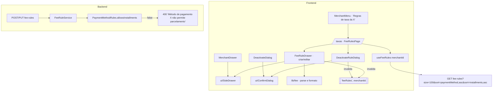

# Tela de Regras de Taxa Design

**Spec**: `.specs/features/fee-rules-screen/spec.md`
**Status**: Approved

---

## Architecture Overview

Backend: `FeeRuleService` passa a aplicar `PaymentMethodRules.allowsInstallments` na criação e na alteração, com a mesma exceção e mensagem da criação de transação. Frontend: primeiro a casca de gaveta e de diálogo de confirmação sai de Empresas para `components/ui/` (escolha do usuário), sem mudar comportamento; depois `/taxas` nasce sobre essa casca, sempre amarrada à empresa selecionada no menu.



---

## Code Reuse Analysis

### Existing Components to Leverage

| Component | Location | How to Use |
| --- | --- | --- |
| `PaymentMethodRules.allowsInstallments` | `backend/.../shared/PaymentMethodRules.java` | Mesma regra das transações |
| `InvalidInstallmentsForPaymentMethodException` → `400 VALIDATION_ERROR` | `GlobalExceptionHandler.java:217` | Mesma exceção e texto de `TransactionService.validateInstallmentsForPaymentMethod` |
| `FeeRuleAlreadyExistsException` → `409` | `FeeRuleService.ensureUniqueFeeRule` | Duplicidade continua igual |
| `MerchantAccessAspect` | `backend/.../security/MerchantAccessAspect.java` | Já protege `/fee-rules` por empresa |
| Casca da gaveta (overlay, `Esc`, foco preso, cabeçalho, rodapé) | `frontend/components/merchants/MerchantDrawer.tsx:81` | Extraída para `ui/SideDrawer` |
| Casca do diálogo (`alertdialog`, `Esc`, erro) | `frontend/components/merchants/DeactivateDialog.tsx:46` | Extraída para `ui/ConfirmDialog` |
| `MerchantsPage` (cabeçalho, tabela, estados) | `frontend/components/merchants/MerchantsPage.tsx` | Mesma estrutura visual em `FeeRulesPage` |
| `NoMerchant`, `BlockError` | `frontend/components/dashboard/states.tsx` | Estado sem empresa e erro da lista |
| `METHOD_LABELS` | `frontend/components/dashboard/format.ts:78` | Rótulos Crédito/Débito/Pix/Boleto |
| `formatMoney` | `frontend/lib/money.ts:5` | Taxa fixa `R$ 0,30` |
| `LosslessNumber` / `DECIMAL_FIELDS` | `frontend/lib/api.ts` | Enviar e receber `feePercentage`/`fixedFee` sem `float` |
| `useSelectedMerchant` | `frontend/components/shell/MerchantMenu.tsx` | Empresa da tela e item do menu |

### Integration Points

| System | Integration Method |
| --- | --- |
| `GET /api/merchants/{id}/fee-rules` | Lista ativa, `size=100`, ordenada por método e parcelas |
| `POST /api/merchants/{id}/fee-rules` | Criação (`201`), `409` duplicada, `400` parcelamento indevido |
| `PUT /api/merchants/{id}/fee-rules/{ruleId}` | Só `feePercentage` e `fixedFee` pela tela |
| `DELETE /api/merchants/{id}/fee-rules/{ruleId}` | Soft delete (`204`) |
| Banco | Nenhuma migration |

---

## Components

### FeeRuleService (backend)

- **Purpose**: Recusar regra parcelada de PIX, boleto e débito.
- **Location**: `backend/src/main/java/br/com/hanrry/reconpay/feerule/service/FeeRuleService.java`
- **Interfaces**: `create` valida `(paymentMethod, installments)` do pedido; `update` valida a combinação resultante (pedido ou valor atual) antes de qualquer `set`; ambos lançam `InvalidInstallmentsForPaymentMethodException("Método de pagamento " + method + " não permite parcelamento")`.
- **Reuses**: `PaymentMethodRules`

### ui/SideDrawer e ui/ConfirmDialog (frontend)

- **Purpose**: Casca única de gaveta lateral e de diálogo de confirmação.
- **Location**: `frontend/components/ui/SideDrawer.tsx`, `frontend/components/ui/ConfirmDialog.tsx`
- **Interfaces**:
  - `SideDrawer({ title, description, formId, submitLabel, pending, error, onClose, children })` — overlay que fecha no clique fora, `role="dialog"` com `aria-label={title}`, `Esc` fecha, `Tab` preso, botões "Cancelar" e `submitLabel` (desabilitado em `pending`), alerta de erro.
  - `ConfirmDialog({ title, warning, confirmLabel, pending, error, onConfirm, onClose })` — `role="alertdialog"`, `Esc` fecha, erro exibido.
- **Reuses**: marcação e classes atuais de `MerchantDrawer` e `DeactivateDialog`; o refactor não muda nenhum texto nem papel ARIA, e os testes de Empresas não mudam.

### lib/fee.ts (frontend)

- **Interfaces**:
  - `parseFeePercent(input): string | null` — `"2,99"`/`"2.99"` → `"2.99"`; `null` se vazio, não numérico, < 0, > 100 ou > 4 casas.
  - `parseFixedFee(input): string | null` — `null` se vazio, não numérico, negativo ou > 2 casas.
  - `formatPercent(value): string` — `"2.9900"` → `"2,99%"`, `"0.0000"` → `"0%"`, `"100.0000"` → `"100%"` (só texto, sem aritmética).
  - `toInputDecimal(value): string` — `"2.9900"` → `"2,99"` para preencher a edição.
  - `SINGLE_INSTALLMENT_METHODS` — Pix, Boleto, Débito.

### API e hooks de regra (frontend)

- **Location**: `frontend/lib/api.ts`, `frontend/lib/queries.ts`
- **Interfaces**:
  - `type FeeRule = { id; merchantId; paymentMethod: PaymentMethod; installments: number; feePercentage: string; fixedFee: string; active: boolean; createdAt: string }`; `feePercentage` e `fixedFee` entram em `DECIMAL_FIELDS`.
  - `getFeeRules(token, merchantId)`, `createFeeRule(token, merchantId, input)`, `updateFeeRuleFees(token, merchantId, ruleId, { feePercentage, fixedFee })`, `deactivateFeeRule(token, merchantId, ruleId)`; decimais enviados com `LosslessNumber`.
  - `useFeeRules(merchantId)`, `useCreateFeeRule(merchantId)`, `useUpdateFeeRuleFees(merchantId)`, `useDeactivateFeeRule(merchantId)` — mutações aguardam a invalidação de `['feeRules', merchantId]`.

### FeeRulesPage, FeeRuleDrawer, DeactivateRuleDialog (frontend)

- **Location**: `frontend/components/fee-rules/`; `frontend/app/(app)/taxas/page.tsx` renderiza `FeeRulesPage`.
- **FeeRulesPage**: cabeçalho "Regras de taxa" + nome da empresa + "Cadastrar regra"; tabela; estados vazio/sem empresa/carregando/erro; gaveta e diálogo fecham quando `merchantId` muda.
- **FeeRuleDrawer**: modo `create` (Método `select`, Parcelas travada em 1 para Pix/Boleto/Débito, Percentual, Taxa fixa) e modo `edit` (Método e Parcelas somente leitura).
- **DeactivateRuleDialog**: "Desativar a regra <Método> <N>x?" e o aviso de transações recusadas.

### MerchantMenu (frontend)

- Novo item no rodapé, só com empresa selecionada: "Regras de taxa da <nome>" → `/taxas`, entre "Gerenciar empresas" e "Cadastrar empresa".

---

## Data Models

```typescript
// GET /api/merchants/{id}/fee-rules (FeeRuleResponseDTO)
type FeeRule = {
  id: string
  merchantId: string
  merchantName: string
  paymentMethod: 'CREDIT_CARD' | 'DEBIT_CARD' | 'PIX' | 'BOLETO'
  installments: number
  feePercentage: string // BigDecimal, até 4 casas
  fixedFee: string      // BigDecimal, 2 casas
  active: boolean
  createdAt: string
}
```

Nenhuma mudança de schema.

---

## Error Handling Strategy

| Error Scenario | Handling | User Impact |
| --- | --- | --- |
| Parcelamento indevido na API | `InvalidInstallmentsForPaymentMethodException` → `400` | Pela tela não acontece (parcelas travadas); mensagem exibida se acontecer |
| Regra ativa duplicada | `409` existente | Gaveta aberta com a mensagem |
| Regra já desativada (`404`) | Mensagem + invalidação da lista | Lista recarregada |
| Rede / `5xx` | `ApiError` | Gaveta ou diálogo com a mensagem |
| `401` | `createQueryClient` | Volta ao login |

---

## Risks & Concerns

| Concern | Location (file:line) | Impact | Mitigation |
| --- | --- | --- | --- |
| Refactor da casca pode mudar comportamento de Empresas | `frontend/components/merchants/MerchantDrawer.tsx`, `DeactivateDialog.tsx` | Regressão em tela já verificada | Task de refactor isolada; os testes de Empresas (`MerchantsPage.test.tsx`) não mudam e precisam passar |
| `FeeRuleService.update` aplica `set` antes de validar | `feerule/service/FeeRuleService.java:83` | Validação depois do `set` deixaria entidade suja na sessão | Validar a combinação resultante antes de qualquer `set`; teste confirma regra inalterada após o `400` |
| Regras parceladas de Pix/Boleto/Débito já gravadas em produção | tabela `fee_rules` | Continuam listadas e editáveis só nas taxas | Sem migration; a tela as mostra como estão; desativar continua possível |
| `FeeRuleResponseDTO` traz `merchantName` | `feerule/dto/FeeRuleResponseDTO.java` | Campo redundante com o menu | Tipo inclui o campo; a tela usa o nome do menu |
| `TransactionService` e `FeeRuleService` duplicam o texto da mensagem | `transaction/service/TransactionService.java:151` | Textos podem divergir no futuro | Aceito; mesma frase copiada, teste de integração fixa o texto nos dois módulos |

---

## Tech Decisions

| Decision | Choice | Rationale |
| --- | --- | --- |
| Casca comum | `ui/SideDrawer` e `ui/ConfirmDialog` usados por Empresas e Regras de taxa; `ResolveDrawer` intocado | Escolha do usuário; terceira gaveta do app |
| Fechar gaveta ao trocar empresa | `FeeRulesPage` reseta estado quando `merchantId` muda | A tela é sempre da empresa selecionada |
| Ordem | `sort=paymentMethod,asc&sort=installments,asc` | Enum gravado como texto (`@Enumerated(STRING)`): Boleto, Crédito, Débito, Pix |
| Parse de decimal | Funções próprias em `lib/fee.ts`, sem `Number()` | AD-010 e valor exato para o `LosslessNumber` |
