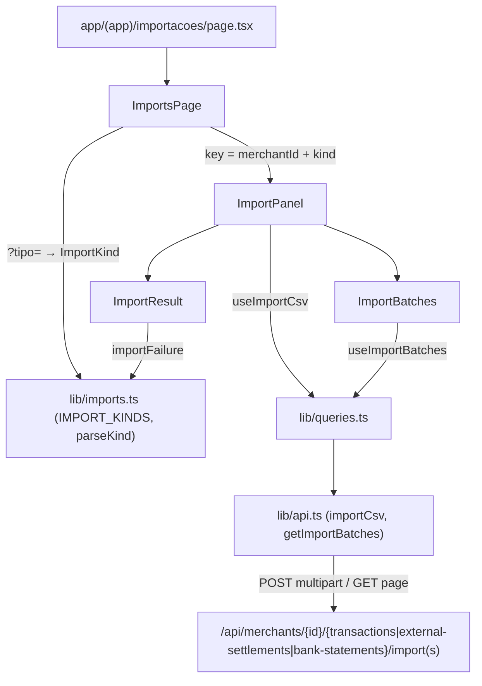

# Tela de Importações Design

**Spec**: `.specs/features/imports-screen/spec.md`
**Status**: Approved

---

## Architecture Overview

Só frontend; a API já tem os três imports e as três listagens. A tela segue o desenho de Empresas e Regras de taxa: chamadas em `lib/api.ts`, regras puras em `lib/imports.ts`, hooks TanStack em `lib/queries.ts`, componentes em `components/imports/` e a rota `app/(app)/importacoes/page.tsx` só monta a página.



O painel de uma aba é montado com `key={merchantId + kind}`. Trocar de empresa ou de aba desmonta o painel e descarta arquivo, resultado e página da lista sem nenhum efeito de limpeza (IMP-13).

---

## Code Reuse Analysis

### Existing Components to Leverage

| Component | Location | How to Use |
| --- | --- | --- |
| `request`, `send`, `ApiError`, `merchantPath`, `Page<T>` | `frontend/lib/api.ts` | Base das chamadas novas; `send` e `ApiError` ganham suporte a multipart e a `details` |
| `SettlementImport` | `frontend/lib/api.ts:181` | Mesmo formato dos três lotes; vira `ImportBatch`, e `SettlementImport` continua como alias para o dashboard |
| `queryKeys.imports`, `useLatestImports` | `frontend/lib/queries.ts:51,121` | Invalidado após import aceito, para o dashboard mostrar a hora do novo import |
| `useSelectedMerchant` | `frontend/components/shell/MerchantMenu.tsx` | Empresa selecionada e estado de carregamento do menu |
| `NoMerchant`, `BlockError` | `frontend/components/dashboard/states.tsx:42,165` | Estado sem empresa e erro da listagem com "Tentar novamente" |
| Tabela e paginação | `frontend/components/merchants/MerchantsPage.tsx:83-138` | Mesma marcação (tabela em `bg-surface`, "Página X de Y", "Anterior"/"Próxima") |
| Skeleton da tabela | `frontend/components/fee-rules/FeeRulesPage.tsx:22` | Mesmo padrão de carregamento |
| Servidor em memória dos testes | `frontend/components/fee-rules/FeeRulesPage.test.tsx` | Mesmo estilo: `fetch` stubado, `next/navigation` e `useAuth` mockados |

### Integration Points

| System | Integration Method |
| --- | --- |
| `POST /api/merchants/{id}/{transactions|external-settlements|bank-statements}/import` | `FormData` com a parte `file`; sem `layout` na liquidação |
| `GET /api/merchants/{id}/{…}/imports?page&size=20&sort=createdAt,desc` | `Page<ImportBatch>` |
| Dashboard | Invalidação de `queryKeys.imports(merchantId)` |
| Barra superior | O item "Importações" já aponta para `/importacoes` (`TopNav.tsx:15`) |

---

## Components

### Cliente da API (`lib/api.ts`)

- **Purpose**: Enviar o CSV como multipart e expor os `details` dos erros.
- **Location**: `frontend/lib/api.ts`
- **Interfaces**:
  - `type ImportKind = 'transactions' | 'settlements' | 'bankStatements'`
  - `type ImportBatch = { id: string; merchantId: string; fileName: string; totalRows: number; createdAt: string }`; `SettlementImport = ImportBatch`
  - `importCsv(token: string, merchantId: string, kind: ImportKind, file: File): Promise<ImportBatch>`: `POST` com `FormData` (`file`)
  - `getImportBatches(token: string, merchantId: string, kind: ImportKind, page: number): Promise<Page<ImportBatch>>`: `?page=<n>&size=20&sort=createdAt%2Cdesc`
  - `ApiError.details: Record<string, unknown> | undefined`: o `details` do `StandardError`, quando for objeto
- **Change in `send`**: `Content-Type: application/json` só quando `body` é `string`; com `FormData`, o navegador define o `multipart/form-data; boundary=…`
- **Reuses**: `request`, `merchantPath`

### Regras da tela (`lib/imports.ts`)

- **Purpose**: Configuração dos três tipos e regras puras, testáveis em node.
- **Location**: `frontend/lib/imports.ts`
- **Interfaces**:
  - `IMPORT_KINDS: readonly { kind: ImportKind; slug: 'transacoes' | 'liquidacao' | 'extrato'; label: string; noun: string; columns: readonly string[] }[]`, na ordem Transações, Liquidação, Extrato. `noun` entra em "Nenhuma importação de <noun> ainda."
  - `kindFromSlug(slug: string | null): ImportKind`: slug desconhecido ou ausente devolve `'transactions'`
  - `MAX_CSV_BYTES = 5 * 1024 * 1024`; `FILE_TOO_LARGE_MESSAGE`
  - `isTooLarge(file: { size: number }): boolean`: `size > MAX_CSV_BYTES`
  - `importFailure(error: unknown): { message: string; rowErrors: { row: number; message: string }[]; conflictingReferences: string[] }`: lê `ApiError.details` com checagem de forma; formato inesperado vira lista vazia
  - `importedRowsMessage(batch: ImportBatch): string`: "<fileName> importado: <totalRows> linha(s)"
  - `formatImportedAt(iso: string, timeZone?: string): string`: `dd/mm/aaaa hh:mm`; `timeZone` só nos testes
- **Reuses**: `ApiError`

### Hooks (`lib/queries.ts`)

- **Interfaces**:
  - `queryKeys.importBatches(merchantId: string, kind?: ImportKind, page?: number)`: prefixo `['importBatches', merchantId, kind]`, separado de `['imports', …]` do dashboard
  - `useImportBatches(merchantId: string, kind: ImportKind, page: number)`
  - `useImportCsv(merchantId: string, kind: ImportKind)`: `onSuccess` invalida `importBatches(merchantId, kind)` e `imports(merchantId)` e só resolve depois que os dois recarregam
- **Reuses**: `useAuth`, padrão de `useCreateFeeRule`

### `ImportsPage`

- **Purpose**: Cabeçalho, abas e estado sem empresa.
- **Location**: `frontend/components/imports/ImportsPage.tsx`
- **Behavior**: lê `?tipo=` com `useSearchParams`, mostra `role="tablist"` com três `role="tab"` (`aria-selected`) e troca de aba com `router.replace('/importacoes?tipo=<slug>')`. Sem empresa, mostra `NoMerchant`; com empresa, `<ImportPanel key={`${merchantId}:${kind}`} />`.
- **Reuses**: `useSelectedMerchant`, `NoMerchant`, `IMPORT_KINDS`

### `ImportPanel`

- **Purpose**: Upload de um tipo, resultado do último envio e lista de lotes (`role="tabpanel"`).
- **Location**: `frontend/components/imports/ImportPanel.tsx`
- **State**: `file: File | null`, `outcome: { batch } | { failure } | null`, `page: number`
- **Behavior**:
  - Mostra as colunas esperadas e um `<input type="file" accept=".csv,text/csv">` com rótulo.
  - "Importar" fica desabilitado sem arquivo ou com envio em andamento; durante o envio, o texto é "Importando…".
  - Ao clicar, limpa `outcome`. Arquivo acima do limite vira `failure` local, sem requisição.
  - Sucesso: guarda o lote, limpa `file` e o valor do input e volta para `page = 0`.
  - Erro: guarda `importFailure(error)` e mantém o arquivo.
- **Reuses**: `useImportCsv`, `isTooLarge`, `importFailure`

### `ImportResult`

- **Purpose**: Mostrar o resultado do último envio.
- **Location**: `frontend/components/imports/ImportResult.tsx`
- **Behavior**:
  - Sucesso: `role="status"` com `importedRowsMessage`.
  - Recusa: `role="alert"` com a mensagem. Se houver `rowErrors`, mostra a tabela "Erros por linha" com as colunas "Linha" e "Erro", com rolagem (`max-h`). Se houver `conflictingReferences`, mostra a lista "Referências já importadas".

### `ImportBatches`

- **Purpose**: Lista paginada dos lotes de um tipo.
- **Location**: `frontend/components/imports/ImportBatches.tsx`
- **Interfaces**: `{ merchantId: string; kind: ImportKind; noun: string; page: number; onPageChange(page: number): void }`
- **Behavior**:
  - Mostra o skeleton enquanto carrega e `BlockError` com a ação "Tentar novamente" se a consulta falha.
  - Sem lotes, mostra "Nenhuma importação de <noun> ainda.".
  - A tabela "Lotes importados" tem as colunas Arquivo, Linhas e Importado em.
  - Com mais de uma página, aparece a navegação de páginas.

---

## Data Models

```typescript
type ImportKind = 'transactions' | 'settlements' | 'bankStatements'
type ImportBatch = { id: string; merchantId: string; fileName: string; totalRows: number; createdAt: string }
type ImportFailure = { message: string; rowErrors: { row: number; message: string }[]; conflictingReferences: string[] }
```

`ImportKind` → caminho: `transactions` → `/transactions`, `settlements` → `/external-settlements`, `bankStatements` → `/bank-statements`.

---

## Error Handling Strategy

| Error Scenario | Handling | User Impact |
| --- | --- | --- |
| `400` com `details.rowErrors` | `importFailure` lê a lista | Mensagem + tabela Linha/Erro com todas as linhas |
| `409` com `details.conflictingReferences` | `importFailure` lê a lista | Mensagem + lista de referências |
| `409` período travado, `413`, `403`, `400` de cabeçalho | Só `message` | Mensagem da API |
| Resposta sem JSON | `send` já monta "A API retornou erro <status>." | Esse texto |
| Falha de rede | `send` já lança "Não foi possível conectar à API. Tente novamente." | Esse texto |
| Arquivo > 5 MB | `isTooLarge` antes do `mutate` | "Arquivo CSV excede o tamanho máximo permitido de 5MB", sem requisição |
| `details` com formato inesperado | `importFailure` ignora o que não for lista de `{row:number,message:string}` / `string` | Só a mensagem |
| Listagem falha | `BlockError` com `refetch` | Mensagem + "Tentar novamente" |
| `401` | `createQueryClient` já encerra a sessão | Volta ao login |

---

## Risks & Concerns

| Concern | Location (file:line) | Impact | Mitigation |
| --- | --- | --- | --- |
| `send` força `Content-Type: application/json` sempre que há corpo | `frontend/lib/api.ts:214` | Multipart chegaria como JSON e a API responderia `415`/`400` | Condicionar ao `typeof body === 'string'`; teste confirma que o `POST` de import não leva esse cabeçalho e que os `POST` JSON continuam levando |
| `ApiError` descarta `details` | `frontend/lib/api.ts:191-238` | Sem erros por linha na tela | Novo campo `details`; testes de `api.test.ts` existentes continuam passando |
| Data/hora dependente do fuso da máquina | `formatImportedAt` | Teste instável entre CI (UTC) e máquina local | Parâmetro `timeZone` opcional, fixado nos testes |
| O dashboard usa a chave `['imports', merchantId]` | `frontend/lib/queries.ts:51` | Chave nova com o mesmo prefixo misturaria os caches | Prefixo separado `importBatches` |
| Next.js 16 com mudanças de API | `frontend/AGENTS.md` | `useSearchParams` e `router.replace` podem ter mudado | Seguir o uso atual de `MerchantsPage`/`FeeRulesPage`, que compila e é testado; consultar `node_modules/next/dist/docs/` se algo falhar |

---

## Tech Decisions (only non-obvious ones)

| Decision | Choice | Rationale |
| --- | --- | --- |
| Reset ao trocar empresa/aba | Remontar `ImportPanel` com `key` | Descarta todo o estado local de uma vez, sem efeitos que esqueçam um campo |
| Abas | `role="tablist"` próprio, sem componente de biblioteca | Três botões; as outras telas também não usam componente de abas |
| Limpar o `<input type="file">` | `ref` e `value = ''` após sucesso | O valor de um input de arquivo não pode ser controlado pelo React |
| Página da lista | Estado em `ImportPanel`, passado a `ImportBatches` | O sucesso do envio precisa voltar a lista para a página 1 |

Nenhuma decisão de nível de projeto: AD-009 (TanStack, nenhum número sem vir da API) e AD-010 (só formatação) são seguidos.
