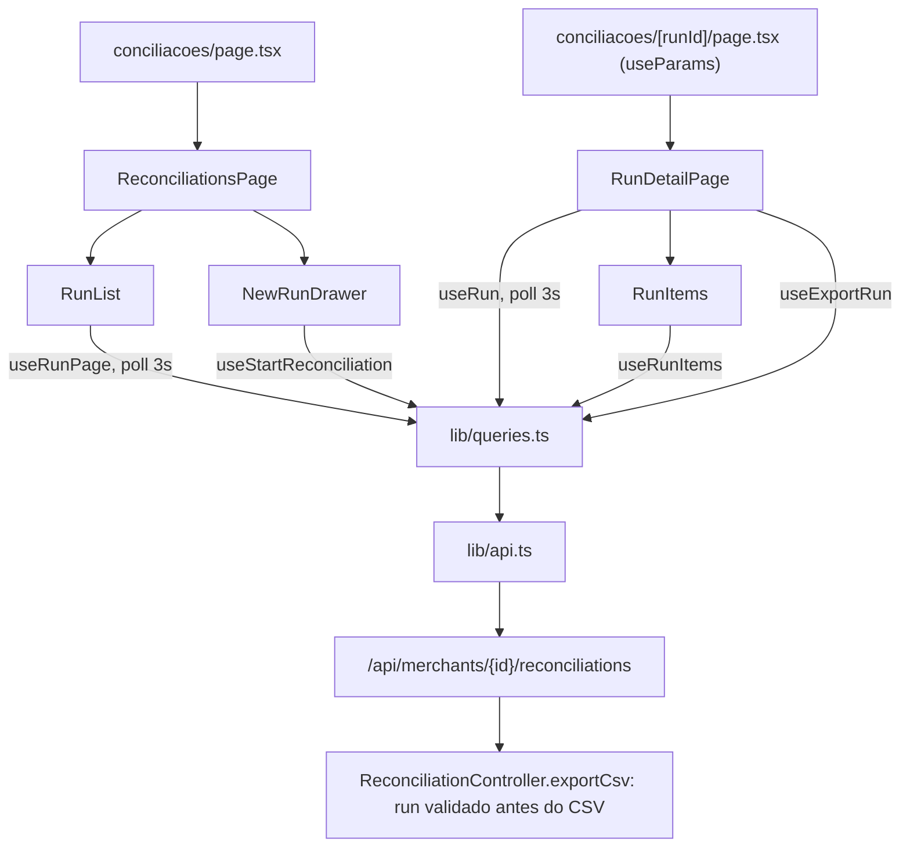

# Tela de Conciliações Design

**Spec**: `.specs/features/reconciliations-screen/spec.md`
**Status**: Approved

---

## Architecture Overview

Uma correção de backend e duas telas novas, sem endpoint novo. O backend valida o run antes de abrir a resposta CSV. No frontend, as duas rotas seguem o padrão das telas anteriores:
- `app/(app)/conciliacoes/page.tsx` mostra a lista e o disparo de conciliação.
- `app/(app)/conciliacoes/[runId]/page.tsx` mostra o detalhe, os itens e o export.

As chamadas ficam em `lib/api.ts`, as regras puras em `lib/reconciliations.ts`, os hooks em `lib/queries.ts` e os componentes em `components/reconciliations/`.

---

## Code Reuse Analysis

### Existing Components to Leverage

| Component | Location | How to Use |
| --- | --- | --- |
| `getRuns` (page, size, window) | `frontend/lib/api.ts` | Lista paginada, com e sem janela |
| `runReconciliation`, `exportRunCsv`, `runPath`, `windowQuery` | `frontend/lib/api.ts` | Disparo e export |
| `Run`, `ReconciliationItem`, `RunStatus`, `DiscrepancyType`, `Page` | `frontend/lib/api.ts` | Tipos |
| `queryKeys.runs`, `RUN_POLL_MS`, `inFlight`, `useExportRun`, `useInvalidateWindow` | `frontend/lib/queries.ts` | Prefixo de invalidação, intervalo, export, invalidação do dashboard |
| `TYPE_LABELS`, `STATUS_LABELS`, `METHOD_LABELS` | `frontend/components/dashboard/format.ts` | Rótulos de divergência e método |
| `formatWindow`, `monthWindow` | `frontend/lib/period.ts` | Janela e mês |
| `recentMonths`, `invalidWindowError`, `INVALID_WINDOW_MESSAGE`, `formatTransactionDate` | `frontend/lib/transactions.ts` | 12 meses, intervalo invertido, data `dd/mm/aaaa` |
| `formatImportedAt` | `frontend/lib/imports.ts` | "Criado em" `dd/mm/aaaa hh:mm` |
| `formatMoney` | `frontend/lib/money.ts` | Valores do item |
| `SideDrawer`, `NoMerchant`, `BlockError` | `frontend/components/ui`, `components/dashboard/states.tsx` | Gaveta, sem empresa, erro |
| Tabela, paginação, filtros em select | `components/transactions/TransactionList.tsx`, `TransactionsPage.tsx` | Mesma marcação |
| Padrão `shownMerchantId` | `components/transactions/TransactionsPage.tsx` | Reset na troca de empresa |
| Download de blob | `components/dashboard/DashboardPage.tsx:160-173` | Mesmo `URL.createObjectURL` + âncora |
| Servidor em memória dos testes | `components/transactions/TransactionsPage.test.tsx` | Mesmo estilo nos testes das páginas |
| `ReconciliationIntegrationTest` (export) | `backend/src/test/java/.../reconciliation/ReconciliationIntegrationTest.java:154,240` | Casos novos de `404` no mesmo arquivo |

### Integration Points

| System | Integration Method |
| --- | --- |
| `GET /reconciliations?page&size=20&sort=createdAt,desc[&fromDate&toDate]` | Lista e filtro de janela |
| `GET /reconciliations/{runId}` | Cabeçalho do detalhe |
| `GET /reconciliations/{runId}/items?page&size=20&sort=absDifference,desc[&result][&discrepancyType]` | Itens |
| `POST /reconciliations` | Disparo (`202`) |
| `GET /reconciliations/{runId}/export` | CSV; `404` em JSON após a correção |

---

## Components

### Backend: `ReconciliationController.exportCsv`

- **Change**: chama `reconciliationService.findRunById(merchantId, runId)` antes de definir `Content-Type`, `Content-Disposition` e de abrir o `OutputStream`. Assim, um run ausente lança `ReconciliationNotFoundException` com a resposta ainda limpa, e o `GlobalExceptionHandler` escreve o `404` em JSON. O `exportCsv` do service continua validando o run, por defesa.
- **Tests**: `ReconciliationIntegrationTest` ganha três casos:
  - run inexistente: `404`, `application/json`, `error=NOT_FOUND` e a mensagem;
  - run de outra empresa: o mesmo `404`;
  - os casos atuais de CSV continuam passando.

### Cliente da API (`lib/api.ts`)

- `getRun(token, merchantId, runId): Promise<Run>`
- `type RunItemFilters = { result?: 'MATCHED' | 'DIVERGENT'; discrepancyType?: DiscrepancyType }`
- `getRunItems(token, merchantId, runId, filters, page): Promise<Page<ReconciliationItem>>`: `?page&size=20&sort=absDifference%2Cdesc[&result][&discrepancyType]`
- `getRuns` existente, já com `page`, `size` e `window`.

### Regras (`lib/reconciliations.ts`)

- `RUN_STATUS_LABELS: Record<RunStatus, string>` (Na fila, Em andamento, Concluída, Falhou)
- `RESULT_LABELS` (Bateram, Divergentes) para o filtro e para a coluna Resultado (singular: Bateu, Divergente)
- `MAX_WINDOW_DAYS = 366`; `windowDays(window)` contado por texto ISO (UTC), sem fuso
- `newRunWindowError(from, to): string | null`, que devolve, nesta ordem:
  - "Informe as duas datas";
  - `INVALID_WINDOW_MESSAGE`;
  - "Janela de conciliação excede o máximo de 366 dias".
- `itemsProgress(run)`: "<processed ?? 0> de <total>" em `RUNNING`, "—" em `PENDING`, `totalItems` nos demais
- `discrepancyBadge(d)`: "<TYPE_LABELS> · <STATUS_LABELS>"
- `anyInFlight(runs)`

### Hooks (`lib/queries.ts`)

- `queryKeys.runPage(merchantId, window | null, page)`: `['runs', merchantId, 'page', from|'all', to|'all', page]`, sob o prefixo `runs`.
- `queryKeys.run(merchantId, runId)`: `['runs', merchantId, 'run', runId]`.
- `queryKeys.runItems(merchantId, runId, filters, page)`: `['runItems', merchantId, runId, …]`.
- `useRunPage(merchantId, window, page)`: `refetchInterval` de `RUN_POLL_MS` enquanto `anyInFlight(content)`.
- `useRun(merchantId, runId)`: polling enquanto `inFlight`.
- `useRunItems(merchantId, runId, filters, page, polling)`: polling quando o run está em andamento.
- `useStartReconciliation(merchantId)`: `mutate(window)` faz o `POST` e, no sucesso, invalida o prefixo `runs` da empresa e a janela do dashboard (`period`, `summary`, `openDiscrepancies`, `discrepancy`). Resolve só depois das invalidações.

### `RunList`

- **Location**: `frontend/components/reconciliations/RunList.tsx`
- **Props**: `{ merchantId, window: Window | null, page, onPageChange }`
- **Behavior**: tabela "Conciliações" com as 7 colunas da spec.
  - Selo "Substituído" quando `supersededAt` não é nulo; `errorMessage` quando o status é `FAILED`.
  - "Ver itens" é um `Link` para `/conciliacoes/<id>`.
  - Paginação, skeleton enquanto carrega, estado vazio e erro com "Tentar novamente".

### `NewRunDrawer`

- **Location**: `frontend/components/reconciliations/NewRunDrawer.tsx`
- **Props**: `{ merchantId, onClose, onStarted(run) }`
- **Behavior**:
  - `SideDrawer` com o título "Nova conciliação" e o botão "Conciliar" ("Conciliando…" durante o envio).
  - O select "Mês" lista `recentMonths` e "Personalizado"; editar De ou Até muda o select para "Personalizado".
  - Valida com `newRunWindowError` antes do envio. A mensagem da API fica na gaveta.

### `ReconciliationsPage`

- **Location**: `frontend/components/reconciliations/ReconciliationsPage.tsx`
- **State**: `window: Window | null` (filtro), `page`, `drawerOpen`.
- **Behavior**:
  - Cabeçalho com o nome da empresa, o título "Conciliações" e o botão "Nova conciliação".
  - O select "Janela" tem "Todas" e os 12 meses; trocar o filtro volta para a página 0.
  - Após o disparo: fecha a gaveta, `window = null`, `page = 0`.
  - Na troca de empresa (padrão `shownMerchantId`): fecha a gaveta e volta para a página 0, mantendo o filtro.
  - Sem empresa: mostra `NoMerchant`.

### `RunItems`

- **Location**: `frontend/components/reconciliations/RunItems.tsx`
- **Props**: `{ merchantId, runId, polling }`
- **State**: `result`, `discrepancyType`, `page`.
- **Behavior**:
  - Selects "Resultado" e "Tipo de divergência"; qualquer filtro volta para a página 0.
  - Tabela "Itens" com as 8 colunas, "—" no lado ausente e os selos de divergência.
  - Paginação, vazio e erro.

### `RunDetailPage`

- **Location**: `frontend/components/reconciliations/RunDetailPage.tsx`
- **Props**: `{ runId }`
- **Behavior**:
  - Usa `useRun`.
  - Com `404`, mostra "Conciliação não encontrada." e o link de volta.
  - O cabeçalho mostra a janela (`formatWindow`), o status, "Criado em", os totais, o selo "Substituído" e o link "Voltar para conciliações".
  - "Exportar CSV" aparece só em `COMPLETED` e baixa `reconciliation-<runId>.csv`, com o erro junto do botão.
  - Monta `RunItems`.
  - Na troca de empresa (o `merchantId` muda depois de carregado), chama `router.replace('/conciliacoes')`.
- **Route**: `app/(app)/conciliacoes/[runId]/page.tsx` é um client component que lê `useParams<{ runId: string }>()` e renderiza `RunDetailPage`. É o hook documentado em `node_modules/next/dist/docs/01-app/03-api-reference/04-functions/use-params.md`, e os testes conseguem mockar.

---

## Data Models

Já existentes em `lib/api.ts`: `Run` (com `processedItems`, `supersededAt`, `errorMessage`) e `ReconciliationItem` (com `netDifference`, lados nulos, `discrepancies`). Os valores monetários chegam como texto (`DECIMAL_FIELDS`). Nenhum modelo novo.

---

## Error Handling Strategy

| Error Scenario | Handling | User Impact |
| --- | --- | --- |
| Export de run inexistente | Backend valida antes do CSV | `404` JSON; a tela mostra a `message` junto do botão |
| Janela inválida no disparo | `newRunWindowError` antes do envio | Mensagem na gaveta, sem requisição |
| `409` run em andamento ou período travado, `400` | `ApiError.message` na gaveta | Gaveta aberta |
| Run inexistente no detalhe | `useRun` com `404` | "Conciliação não encontrada." + link de volta |
| Lista ou itens falham | `BlockError` com `refetch` | Mensagem + "Tentar novamente" |
| `401` | `createQueryClient` encerra a sessão | Volta ao login |

---

## Risks & Concerns

| Concern | Location (file:line) | Impact | Mitigation |
| --- | --- | --- | --- |
| Export abre a resposta CSV antes de validar o run | `backend/.../reconciliation/controller/ReconciliationController.java:89-98` | `404` vira erro de servlet | Validar antes dos cabeçalhos; testes de integração com `404` JSON |
| `latestRun` e a nova `runPage` dividem o prefixo `['runs', merchantId]` | `frontend/lib/queries.ts:51` | Chaves com o mesmo formato colidiriam | Segmento literal `'page'`/`'run'` na chave; o prefixo comum é intencional para invalidar tudo de uma vez |
| Polling sem fim se a API ficar presa em `RUNNING` | `useRunPage`, `useRun` | Requisições a cada 3 s | Mesmo comportamento do dashboard; o backend devolve runs presos a `PENDING` no restart |
| Rota dinâmica no Next 16 | `app/(app)/conciliacoes/[runId]/page.tsx` | API de params mudou (Promise em server components) | Client component com `useParams`, documentado na versão instalada |
| `formatImportedAt` mora em `lib/imports.ts` | `frontend/lib/imports.ts` | Reuso entre módulos | Importar de lá; mover para um módulo comum fica fora de escopo |

---

## Tech Decisions (only non-obvious ones)

| Decision | Choice | Rationale |
| --- | --- | --- |
| Correção do export | Validar no controller antes de abrir a resposta | A resposta CSV não pode virar JSON depois de aberta; mudar o handler global seria mais amplo |
| Rota do detalhe | Client component com `useParams` | Testável com mock; não depende de server component assíncrono |
| Filtro de janela | Select de meses, não `PeriodMenu` | A API filtra pela janela exata; um intervalo livre raramente bate com um run |
| Polling | `refetchInterval` condicional no próprio hook | Mesmo mecanismo de `useLatestRun` |

Nenhuma decisão de nível de projeto: AD-006 (OpenAPI nas interfaces `*Api`, sem mudança de contrato), AD-009 e AD-010 são seguidos.
