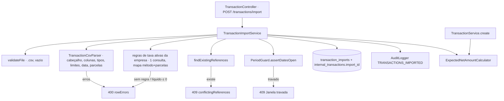

# Import CSV de Transações Design

**Spec**: `.specs/features/transaction-csv-import/spec.md`
**Status**: Approved

---

## Architecture Overview

O import segue o desenho do import de liquidação (`externalsettlement`): um parser de CSV sem acesso a banco valida formato linha a linha; um service valida o que depende do banco (regra de taxa, referências já cadastradas, período travado), grava o lote e as transações numa transação só e registra auditoria. O cálculo do líquido esperado sai do `TransactionService` para um componente único, usado pelo cadastro unitário e pelo import, garantindo o mesmo resultado (TIMP-03).



---

## Code Reuse Analysis

### Existing Components to Leverage

| Component | Location | How to Use |
| --- | --- | --- |
| `SettlementCsvParser` | `backend/.../externalsettlement/service/SettlementCsvParser.java` | Mesma estrutura (OpenCSV, cabeçalho fixo, `rowNumber`, linhas em branco, coleta de erros) e mesmos textos de erro |
| `ImportRowErrorDTO` | `backend/.../externalsettlement/dto/ImportRowErrorDTO.java` | Mesmo `{row, message}` em `rowErrors` |
| `ExternalSettlementService.importCsv` / `validateFile` | `backend/.../externalsettlement/service/ExternalSettlementService.java:55` | Mesma ordem: arquivo → parse → duplicadas → período → lote → itens → auditoria |
| `TransactionService.calculateExpectedNetAmount` | `backend/.../transaction/service/TransactionService.java:172` | Extraído para `ExpectedNetAmountCalculator`, sem mudar o cálculo |
| `IInternalTransactionRepository.findExistingReferences` | `backend/.../transaction/repository/IInternalTransactionRepository.java:25` | Referências já cadastradas numa consulta |
| `IFeeRuleRepository.findAllByMerchant_IdAndActiveTrue` | `backend/.../feerule/repository/IFeeRuleRepository.java:14` | Regras ativas carregadas uma vez (sem N+1 por linha) |
| `PeriodGuard.assertDatesOpen` | `backend/.../reconciliation/service/PeriodGuard.java` | Período travado → `409` com a mesma mensagem |
| `PaymentMethodRules.allowsInstallments` | `backend/.../shared/PaymentMethodRules.java` | Parcelamento indevido |
| `BankStatementImportEntity` + `V21` | `backend/.../bankstatement/entity/`, `db/migration/V21__create_bank_statement_tables.sql` | Mesmo formato de tabela de lote |
| `MerchantAccessAspect` | `backend/.../security/MerchantAccessAspect.java` | Acesso por empresa nos três endpoints novos (já cobre controllers) |
| `MaxUploadSizeExceededException` → `413` | `GlobalExceptionHandler` | Limite de 5 MB já global |

### Integration Points

| System | Integration Method |
| --- | --- |
| Banco | Migration `V24__create_transaction_imports.sql`: tabela `transaction_imports` e coluna `internal_transactions.import_id` (nula, FK, índice) |
| Segurança | `PATH_MERCHANT_TRANSACTIONS` (`/api/merchants/*/transactions/**`) já cobre os endpoints novos |
| OpenAPI | Endpoints documentados em `TransactionControllerApi` (AD-006) |

---

## Components

### ExpectedNetAmountCalculator

- **Purpose**: Calcular o líquido esperado de uma venda com uma regra de taxa.
- **Location**: `backend/src/main/java/br/com/hanrry/reconpay/feerule/service/ExpectedNetAmountCalculator.java`
- **Interfaces**: `BigDecimal calculate(BigDecimal amount, FeeRuleEntity feeRule)` — mesma fórmula e arredondamento de hoje; lança `InvalidTransactionAmountException("Valor líquido esperado deve ser maior que zero")` quando ≤ 0.
- **Reuses**: corpo de `TransactionService.calculateExpectedNetAmount`, que passa a delegar.

### TransactionCsvParser

- **Purpose**: Ler o CSV e devolver as linhas tipadas ou todos os erros de formato.
- **Location**: `backend/src/main/java/br/com/hanrry/reconpay/transaction/service/TransactionCsvParser.java`
- **Interfaces**: `ParseResult parse(InputStream)` com `record ParseResult(List<ParsedTransactionRow> rows, List<ImportRowErrorDTO> errors)` e `record ParsedTransactionRow(int rowNumber, String externalReference, BigDecimal amount, PaymentMethod paymentMethod, int installments, TransactionStatus status, LocalDate transactionDate)`. Erros de arquivo (vazio, cabeçalho, sem registros) → `InvalidTransactionImportException`; erros de linha voltam em `errors` (sem lançar) para o service somar os de regra de taxa; usa `Clock` para "data futura".
- **Reuses**: estrutura e textos de `SettlementCsvParser`.

### TransactionImportService

- **Purpose**: Orquestrar o import tudo-ou-nada e consultar lotes.
- **Location**: `backend/src/main/java/br/com/hanrry/reconpay/transaction/service/TransactionImportService.java`
- **Interfaces**:
  - `TransactionImportResponseDTO importCsv(UUID merchantId, MultipartFile file)` (`@Transactional`): empresa ativa → `validateFile` → parse → regra por linha e líquido só nas linhas sem erro de formato, somados aos erros do parser e ordenados por linha num único `TransactionImportValidationException` → `findExistingReferences` → `DuplicateTransactionReferenceException` (`409`, referências na ordem do arquivo) → `periodGuard.assertDatesOpen` → salva lote → `saveAll` das transações → auditoria.
  - `Page<TransactionImportResponseDTO> findAllImports(UUID merchantId, Pageable)`; `TransactionImportResponseDTO findImportById(UUID merchantId, UUID importId)` → `TransactionImportNotFoundException` (`404`).
- **Reuses**: padrão de `ExternalSettlementService`, `ExpectedNetAmountCalculator`, `PeriodGuard`, `AuditLogger`.

### Exceções e handler

- **Location**: `backend/.../exception/`
- `InvalidTransactionImportException` (entra na lista de `400` com mensagem), `TransactionImportValidationException` (`400` com `rowErrors`), `DuplicateTransactionReferenceException` (`409` com `conflictingReferences`), `TransactionImportNotFoundException` (entra na lista de `404`).
- Os handlers de `rowErrors` e `conflictingReferences` passam a aceitar também os tipos novos, com o mesmo corpo.

### TransactionImportEntity, repositório, DTO e mapper

- `transaction/entity/TransactionImportEntity.java` (mesmos campos de `BankStatementImportEntity`), `transaction/repository/ITransactionImportRepository.java` (`findAllByMerchant_Id`, `findByIdAndMerchant_Id`), `transaction/dto/TransactionImportResponseDTO.java` (`id`, `merchantId`, `fileName`, `totalRows`, `createdAt`), mapper MapStruct.
- `InternalTransactionEntity` ganha `@ManyToOne(fetch = LAZY) importBatch` (`import_id`, nulo).

### Endpoints (controller + `TransactionControllerApi`)

- `POST /api/merchants/{merchantId}/transactions/import` (multipart `file`) → `201` com o lote.
- `GET /api/merchants/{merchantId}/transactions/imports` (`@PageableDefault(size = 20, sort = "createdAt", direction = DESC)`).
- `GET /api/merchants/{merchantId}/transactions/imports/{importId}`.

---

## Data Models

```sql
-- V24__create_transaction_imports.sql
CREATE TABLE transaction_imports (
    id UUID PRIMARY KEY,
    merchant_id UUID NOT NULL REFERENCES merchants(id),
    file_name VARCHAR(255) NOT NULL,
    total_rows INTEGER NOT NULL CHECK (total_rows > 0),
    created_at TIMESTAMP NOT NULL
);
CREATE INDEX idx_transaction_imports_merchant_created_at ON transaction_imports (merchant_id, created_at DESC);

ALTER TABLE internal_transactions ADD COLUMN import_id UUID REFERENCES transaction_imports(id);
CREATE INDEX idx_internal_transactions_import ON internal_transactions (import_id);
```

Nome e formato das constraints seguem o `V21`. Transações existentes ficam com `import_id` nulo.

---

## Error Handling Strategy

| Error Scenario | Handling | User Impact |
| --- | --- | --- |
| Arquivo vazio, não `.csv`, cabeçalho errado, só cabeçalho | `InvalidTransactionImportException` → `400` com a mensagem | Corrige o arquivo |
| Erros de linha (formato, regra de taxa, líquido ≤ 0) | `TransactionImportValidationException` → `400` `rowErrors` | Todos os erros de uma vez |
| Referência já cadastrada | `DuplicateTransactionReferenceException` → `409` `conflictingReferences` | Remove ou troca as referências |
| Período travado | `PeriodConflictException` existente → `409` | Destrava ou tira as datas |
| Corrida de dois imports com a mesma referência | Índice único existente → `DataIntegrityViolationException` → `409` existente | Tenta de novo |
| > 5 MB | `MaxUploadSizeExceededException` → `413` existente | Divide o arquivo |

---

## Risks & Concerns

| Concern | Location (file:line) | Impact | Mitigation |
| --- | --- | --- | --- |
| Duas cópias do cálculo de líquido divergirem | `transaction/service/TransactionService.java:172` | Import e cadastro dariam líquidos diferentes | Extrair `ExpectedNetAmountCalculator` antes (T1); teste do cálculo único e teste de integração comparando import × `POST` |
| Regra de taxa consultada por linha (N+1) | — | Arquivo de milhares de linhas lento | Carregar as regras ativas da empresa uma vez num mapa `(método, parcelas)` |
| Parser duplica estrutura do `SettlementCsvParser` | `externalsettlement/service/SettlementCsvParser.java` | Mudança de formato comum precisa ser feita em dois lugares | Aceito: colunas e regras diferem; extrair base comum quando o terceiro parser de vendas surgir |
| `findExistingReferences` devolve `Set` sem ordem | `IInternalTransactionRepository.java:25` | Ordem de `conflictingReferences` instável nos testes | Filtrar as referências do arquivo na ordem das linhas |
| Linhas de `rowErrors` fora de ordem quando erros de regra somam aos de formato | — | Resposta confusa | Ordenar os erros por linha (estável dentro da linha) antes de lançar |

---

## Tech Decisions

| Decision | Choice | Rationale |
| --- | --- | --- |
| Parser novo × base comum com a liquidação | Parser próprio no módulo `transaction`, mesmos textos | Colunas e regras diferentes; mantém módulos independentes |
| Erros de regra de taxa junto dos de formato | O parser devolve linhas válidas e erros; o service checa regra e líquido só nas linhas válidas e junta tudo, ordenado por linha | TIMP-09 pede todos os erros de todas as linhas; linha com erro de formato não ganha erro de regra em cascata |
| Exceções próprias de transação | Novas classes, mesmos corpos de resposta | Nomes atuais são de liquidação (`Settlement...`); evita acoplamento entre módulos |
| Endpoints no controller de transações | `TransactionController` + `TransactionControllerApi` | Mesmo recurso (`/transactions`), AD-006 |
