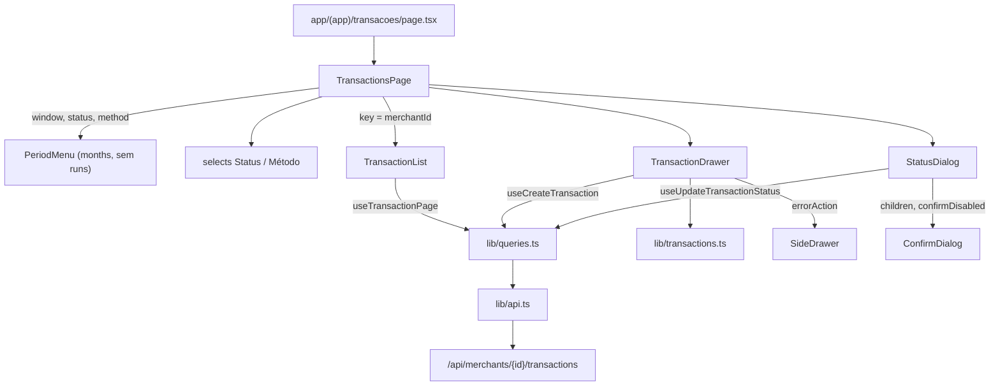

# Tela de Transações Design

**Spec**: `.specs/features/transactions-screen/spec.md`
**Status**: Approved

---

## Architecture Overview

Só frontend; a API já lista, cadastra e muda status. Segue o desenho de Regras de taxa e Importações: chamadas em `lib/api.ts`, regras puras em `lib/transactions.ts`, hooks em `lib/queries.ts`, componentes em `components/transactions/` e a rota `app/(app)/transacoes/page.tsx` só monta a página. Três peças compartilhadas ganham props opcionais, sem mudar o comportamento atual: `PeriodMenu`, `ConfirmDialog` e `SideDrawer`.

---

## Code Reuse Analysis

### Existing Components to Leverage

| Component | Location | How to Use |
| --- | --- | --- |
| `PeriodMenu`, `windowKey` | `frontend/components/dashboard/PeriodMenu.tsx` | Menu de período; ganha `months` opcional e `runs`/`locks` opcionais |
| `monthWindow`, `monthsBack`, `formatWindow`, `Window` | `frontend/lib/period.ts` | Mês atual e os 12 meses do menu |
| `SideDrawer` | `frontend/components/ui/SideDrawer.tsx` | Gaveta do cadastro; ganha `errorAction` opcional (link P2) |
| `ConfirmDialog` | `frontend/components/ui/ConfirmDialog.tsx` | Diálogo de status; ganha `children` e `confirmDisabled` opcionais |
| `FeeRuleDrawer` (padrão de `Field`, `invalidProps`, `sending` ref, foco inicial) | `frontend/components/fee-rules/FeeRuleDrawer.tsx` | Mesmo padrão de formulário; `METHOD_REQUIRED_MESSAGE` e `INSTALLMENTS_MESSAGE` reaproveitados |
| `SINGLE_INSTALLMENT_METHODS` | `frontend/lib/fee.ts` | Parcelas fixas em 1 |
| `CREATE_FEE_RULE_HREF` | `frontend/components/fee-rules/FeeRulesPage.tsx` | Destino do link P2 |
| `METHOD_LABELS` | `frontend/components/dashboard/format.ts` | Rótulos de método |
| `formatMoney` | `frontend/lib/money.ts` | Bruto e líquido esperado |
| `Transaction`, `TransactionStatus`, `PaymentMethod`, `Page`, `request`, `merchantPath`, `LosslessNumber`/`stringify` | `frontend/lib/api.ts` | Tipos e envio de decimal exato |
| `NoMerchant`, `BlockError` | `frontend/components/dashboard/states.tsx` | Sem empresa e erro da lista |
| Tabela e paginação | `frontend/components/imports/ImportBatches.tsx` | Mesma marcação |
| Servidor em memória dos testes | `frontend/components/fee-rules/FeeRulesPage.test.tsx`, `components/imports/ImportsPage.test.tsx` | Mesmo estilo no teste da página |

### Integration Points

| System | Integration Method |
| --- | --- |
| `GET /api/merchants/{id}/transactions` | `?fromDate&toDate[&status][&paymentMethod]&page&size=20&sort=transactionDate%2Cdesc` |
| `POST /api/merchants/{id}/transactions` | JSON com `amount` como número literal do texto digitado |
| `PATCH /api/merchants/{id}/transactions/{tid}/status` | `{ "status": "CANCELLED" \| "REFUNDED" \| "CHARGEBACK" }` |
| `/taxas?cadastrar=1` | Link do erro de regra ausente (P2) |

---

## Components

### `PeriodMenu` (refactor)

- **Change**: novas props opcionais `months?: Window[]`. `runs` e `locks` passam a ser opcionais.
  - Com `months`, o menu lista esses meses.
  - Sem `runs`, os itens não mostram "Aberto", "Sem run" nem cadeado, e o parágrafo sobre a liquidação some.
  - Sem `months`, o dashboard continua como hoje.
- **Erro do intervalo**: continua vindo de `onApply` rejeitado, então o menu não ganha regra nova.

### `ConfirmDialog` e `SideDrawer` (props opcionais)

- `ConfirmDialog`: `children?: ReactNode`, renderizado entre o aviso e o erro; `confirmDisabled?: boolean`, somado a `pending` no botão de confirmar.
- `SideDrawer`: `errorAction?: ReactNode`, renderizado dentro da caixa de erro, depois da mensagem.
- Os testes atuais desses componentes continuam passando sem alteração.

### Cliente da API (`lib/api.ts`)

- `type TransactionFilters = { window: Window; status?: TransactionStatus; paymentMethod?: PaymentMethod }`
- `type TransactionInput = { externalReference: string; amount: string; paymentMethod: PaymentMethod; installments: number; transactionDate: string }`
- `getTransactionPage(token, merchantId, filters, page): Promise<Page<Transaction>>`
- `createTransaction(token, merchantId, input): Promise<Transaction>`: `amount` enviado como `LosslessNumber`.
- `updateTransactionStatus(token, merchantId, transactionId, status): Promise<Transaction>`

### Regras (`lib/transactions.ts`)

- `TRANSACTION_STATUS_LABELS: Record<TransactionStatus, string>` (Aprovada, Cancelada, Estornada, Chargeback)
- `FINAL_STATUSES: readonly TransactionStatus[] = ['CANCELLED', 'REFUNDED', 'CHARGEBACK']`
- `parseAmount(input): string | null`: maior que zero, até 17 dígitos inteiros e 2 casas, vírgula ou ponto. Devolve o literal normalizado ou `null`.
- `parseReference(input): { value: string } | { error: string }`: remove os espaços das extremidades e aplica as regras de obrigatório e de até 100 caracteres.
- `dateError(date: string, today: string): string | null`: vazio ou futuro. A comparação é por texto ISO, sem fuso.
- `todayIso(now = new Date()): string`: data local `aaaa-mm-dd`.
- `recentMonths(today: Date): Window[]`: o mês atual e os 11 anteriores.
- `invalidWindowError(window: Window): string | null`: devolve a mensagem quando `fromDate > toDate`.
- `isMissingFeeRule(error): boolean`: `ApiError` com a mensagem exata da API para regra ausente.
- `formatTransactionDate(iso: string)`: `dd/mm/aaaa` por texto.
- Constantes com as mensagens da spec.

### Hooks (`lib/queries.ts`)

- `queryKeys.transactions(merchantId, filters?, page?)`: o prefixo `['transactions', merchantId]` serve para invalidar.
- `useTransactionPage(merchantId, filters, page)`
- `useCreateTransaction(merchantId)` e `useUpdateTransactionStatus(merchantId)`: as duas invalidam o prefixo da empresa antes de resolver.

### `TransactionList`

- **Location**: `frontend/components/transactions/TransactionList.tsx`
- **Props**: `{ merchantId, filters, page, onPageChange, onChangeStatus(transaction) }`
- **Behavior**:
  - Tabela "Transações" com as 7 colunas da spec e a ação "Alterar status" só em `APPROVED`.
  - Paginação, skeleton enquanto carrega, estado vazio e `BlockError` com "Tentar novamente".

### `TransactionDrawer`

- **Location**: `frontend/components/transactions/TransactionDrawer.tsx`
- **Props**: `{ merchantId, onClose, onCreated(transaction) }`
- **Behavior**:
  - Campos e validação da spec.
  - Data com `max=today`.
  - Pix, Boleto e Débito fixam Parcelas em 1.
  - Erro da API exibido com `errorAction` (o link) quando `isMissingFeeRule`.

### `StatusDialog`

- **Location**: `frontend/components/transactions/StatusDialog.tsx`
- **Props**: `{ merchantId, transaction, onClose }`
- **Behavior**:
  - `ConfirmDialog` com título "Alterar status" e o aviso citando a referência mais "A mudança não pode ser desfeita.".
  - `radiogroup` com Cancelada, Estornada e Chargeback.
  - O rótulo do botão é "Confirmar", ou "Confirmando…" durante o envio.
  - No erro, o diálogo fica aberto e a lista é invalidada.

### `TransactionsPage`

- **Location**: `frontend/components/transactions/TransactionsPage.tsx`
- **State**: `window` (mês atual), `status`, `method`, `page`, `drawerOpen`, `changing: Transaction | null`, `created: Transaction | null`.
- **Behavior**:
  - Cabeçalho com o nome da empresa, o título "Transações" e o botão "Nova transação".
  - Filtros: `PeriodMenu` com `months=recentMonths(today)`, e `onApply` rejeita intervalo invertido. Selects "Status" e "Método", cada um com "Todos". Qualquer filtro volta para a página 0.
  - Troca de empresa: o mesmo padrão `shownMerchantId` de `FeeRulesPage` fecha gaveta e diálogo, limpa o aviso e zera a página, mantendo os filtros.
  - Sem empresa, mostra `NoMerchant`.

---

## Data Models

`Transaction` (já existe em `lib/api.ts`): `id, merchantId, externalReference, amount, expectedNetAmount, paymentMethod, installments, status, transactionDate, createdAt, updatedAt`. `amount` e `expectedNetAmount` chegam como texto (`DECIMAL_FIELDS`).

---

## Error Handling Strategy

| Error Scenario | Handling | User Impact |
| --- | --- | --- |
| Campo inválido no formulário | Validação antes do `mutate` | Mensagem no campo, sem requisição |
| `409` referência repetida, `409` período travado, `400` | `ApiError.message` na gaveta | Gaveta aberta, campos mantidos |
| `409` sem regra de taxa ativa | `isMissingFeeRule` | Mensagem + link "Cadastrar regra de taxa" |
| `400` transição inválida, `409` período travado ou versão | Mensagem no diálogo + invalidação da lista | Diálogo aberto; a lista mostra o estado atual |
| Lista falha | `BlockError` com `refetch` | Mensagem + "Tentar novamente" |
| Intervalo invertido | `onApply` rejeita com a mensagem | Erro dentro do menu, sem busca |
| `401` | `createQueryClient` encerra a sessão | Volta ao login |

---

## Risks & Concerns

| Concern | Location (file:line) | Impact | Mitigation |
| --- | --- | --- | --- |
| `PeriodMenu` é acoplado a runs e travamentos do dashboard | `frontend/components/dashboard/PeriodMenu.tsx:13-36` | Reuso exigiria runs falsos | Props opcionais; os testes do dashboard ficam inalterados e provam que nada mudou lá |
| Falta de regra e referência repetida têm o mesmo `409 CONFLICT` | `backend/.../exception/handler/GlobalExceptionHandler.java:156-165` | O link P2 depende do texto da mensagem | Comparar com o texto exato da spec, fixado em teste; se a API mudar o texto, o link some, mas a mensagem continua |
| "Hoje" depende do fuso do navegador | `todayIso` | Data futura aceita ou recusada errado perto da meia-noite | Data local do navegador, a mesma que o operador vê; `now` injetável nos testes |
| `getTransactions` (5 itens) não tem uso | `frontend/lib/api.ts:295` | Código morto | Fora de escopo; não mexer |
| Next.js 16 com mudanças de API | `frontend/AGENTS.md` | Hooks de navegação podem diferir | A tela não usa `useSearchParams`; o resto segue o padrão das telas existentes |

---

## Tech Decisions (only non-obvious ones)

| Decision | Choice | Rationale |
| --- | --- | --- |
| Reuso do menu de período | Props opcionais em `PeriodMenu` em vez de um menu novo | O usuário pediu o mesmo seletor; uma cópia divergiria |
| Opções do status | `radiogroup` dentro do `ConfirmDialog` | Mantém o foco, o `Esc` e o visual dos outros diálogos |
| Lista por empresa | `TransactionList` com `key={merchantId}` | A troca de empresa descarta o estado da lista |
| Filtros fora da URL | Estado local | Decisão da spec; sem `useSearchParams` |

Nenhuma decisão de nível de projeto: AD-009, AD-010 (só formatação, valor enviado como texto exato), AD-011 e AD-012 (link para `/taxas?cadastrar=1`) são seguidos.
