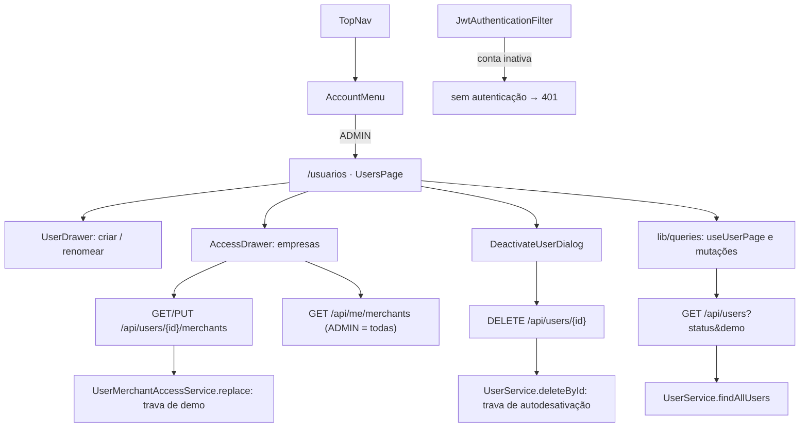

# Tela de Usuários Design

**Spec**: `.specs/features/users-screen/spec.md`
**Status**: Approved

---

## Architecture Overview

O backend ganha três ajustes no módulo `auth` e um no filtro JWT; o resto já existe. O frontend ganha o menu do avatar e a rota `/usuarios`, no mesmo molde de `/empresas` (página + painel lateral + diálogo de confirmação), sobre TanStack Query (AD-009).



---

## Code Reuse Analysis

### Existing Components to Leverage

| Component | Location | How to Use |
| --- | --- | --- |
| Endpoints de usuário | `backend/.../auth/controller/UserController.java` | Todos ficam; só a listagem ganha parâmetros |
| `MethodArgumentTypeMismatchException` → `400` | `backend/.../exception/handler/GlobalExceptionHandler.java:33` | `status` inválido vira `400` sem código novo |
| Lista de `409` `CONFLICT` | `GlobalExceptionHandler.java:152` | A exceção nova entra nessa lista |
| `AuthenticatedUserAccessor.requirePrincipal()` | `backend/.../security/AuthenticatedUserAccessor.java` | Id do ADMIN logado na trava de autodesativação |
| `IUserMapper` (MapStruct) | `backend/.../auth/mapper/IUserMapper.java` | Mapeia `demoExpiresAt` pelo nome, sem código |
| Molde da tela de empresas | `frontend/components/merchants/MerchantsPage.tsx`, `MerchantDrawer.tsx`, `DeactivateDialog.tsx` | Tabela, paginação, volta de página vazia, aviso `role="status"`, painel e confirmação |
| `SideDrawer`, `ConfirmDialog` | `frontend/components/ui/` | Painéis e confirmação |
| Popover com `Esc` e clique fora | `frontend/components/shell/MerchantMenu.tsx:80-99` | Mesmo mecanismo no menu do avatar |
| `getMerchants` | `frontend/lib/api.ts:287` | Lista todas as empresas ativas para o ADMIN no editor de acessos |
| `initials` e o avatar | `frontend/components/shell/TopNav.tsx:22,62` | O avatar vira o botão do menu |
| Formato de data da demo | `frontend/components/shell/DemoBanner.tsx` | Selo "Demo · expira em dd/MM às HH:mm" |

### Integration Points

| System | Integration Method |
| --- | --- |
| `GET /api/users` | Novos `status` (`ACTIVE` padrão) e `demo` (`false` padrão); a chamada sem parâmetros continua só com ativos, agora sem demos |
| Banco | Sem migration: `users.active` e `users.demo_expires_at` já existem |
| Autenticação | O filtro JWT passa a recusar conta inativa; o login não muda |

---

## Components

### Backend: `UserStatusFilter`

- **Purpose**: Valores aceitos em `status`.
- **Location**: `backend/.../auth/enums/UserStatusFilter.java`
- **Interfaces**: `ACTIVE`, `INACTIVE`, `ALL`
- **Reuses**: o binding de enum do Spring; um valor fora da lista cai no `400` existente.

### Backend: listagem filtrada

- **Purpose**: USERS-02 AC1–7.
- **Location**: `UserControllerApi`, `UserController`, `UserService.findAllUsers`, `IUserRepository`
- **Interfaces**:
  - `GET /api/users?status=ACTIVE|INACTIVE|ALL&demo=false|true&page&size&sort`
  - `IUserRepository.findAllFiltered(Boolean active, boolean includeDemo, Pageable)`: `@Query` JPQL `WHERE (:active IS NULL OR u.active = :active) AND (:includeDemo = TRUE OR u.demoExpiresAt IS NULL)`. `ALL` passa `active = null`.
  - `UserResponseDTO` ganha `Instant demoExpiresAt` (fim do record).
- **Reuses**: `@PageableDefault(size = 20)`, o OpenAPI da interface `*Api` (AD-006), com os dois parâmetros e o campo novo no exemplo.

### Backend: `UserAccountConflictException`

- **Purpose**: As duas recusas `409` novas, com a mensagem da spec.
- **Location**: `backend/.../exception/UserAccountConflictException.java`; entra na lista de `handleConflict`.
- **Uso**:
  - `UserService.deleteById`: se `id` = id do principal, lança "Você não pode desativar a própria conta." antes de ler ou gravar.
  - `UserMerchantAccessService.replace`: carrega o usuário (hoje só `existsById`); se `demoExpiresAt != null`, lança "Contas de demonstração não recebem acesso a outras empresas." antes de validar merchants. `grantIfAbsent` não muda: a demo continua recebendo o próprio merchant ao criar (AD-003, AD-013).

### Backend: sessão de conta inativa

- **Purpose**: USERS-04 AC5.
- **Location**: `backend/.../security/JwtAuthenticationFilter.java:65`
- **Mudança**: depois de `loadUserByUsername`, `if (!userDetails.isEnabled()) return;`, ficando sem autenticação. O entry point responde `401`, como já faz para conta apagada.
- **Por que no filtro e não no `UserDetailsServiceImpl`**: o login depende do `DisabledException` que o `DaoAuthenticationProvider` lança para conta inativa ("Confirme seu e-mail…", `GlobalExceptionHandler.java:76`). Recusar no `loadUserByUsername` trocaria essa mensagem por "credenciais inválidas".

### Frontend: API e queries

- **Location**: `frontend/lib/api.ts`, `frontend/lib/queries.ts`
- **Interfaces**:
  - `type User = { id; name; email; role: 'ADMIN' | 'OPERATOR'; active: boolean; createdAt: string; demoExpiresAt: string | null }`
  - `type UserFilters = { status: 'ACTIVE' | 'INACTIVE' | 'ALL'; demo: boolean }`
  - `getUserPage(token, filters, page)` → `GET /api/users?status=…&demo=…&page=…&size=20&sort=name%2Casc`
  - `createUser(token, { name, email, password, role })`, `renameUser(token, id, name)`, `deactivateUser(token, id)`, `activateUser(token, id)`
  - `getUserAccess(token, id)` → `string[]`; `replaceUserAccess(token, id, merchantIds)`
  - Hooks: `useUserPage(filters, page, enabled)`, `useUserAccess(id)`, `useCreateUser`, `useRenameUser`, `useDeactivateUser`, `useActivateUser`, `useReplaceUserAccess`; cada mutação invalida `queryKeys.userPage()`.
- **Reuses**: `request`, `ApiError`, `Page<T>` e o padrão de chaves de `queryKeys`.

### Frontend: `AccountMenu`

- **Purpose**: USERS-01.
- **Location**: `frontend/components/shell/AccountMenu.tsx`; `TopNav` troca o `<span role="img">` por ele e mantém o botão "Sair".
- **Interface**: botão com as iniciais, `aria-haspopup="menu"`, `aria-expanded`; painel `role="menu"` com nome, e-mail, selo ("Admin"/"Operador"), `Link` "Usuários" (`role="menuitem"`, só ADMIN) e botão "Sair" (`signOut`).
- **Reuses**: o mecanismo de fechar do `MerchantMenu` (`mousedown` fora e `Esc`) e o visual do popover.

### Frontend: `UsersPage` e rota

- **Purpose**: USERS-02, e o ponto de onde abrem os painéis.
- **Location**: `frontend/app/(app)/usuarios/page.tsx` (fino, como `empresas/page.tsx`) e `frontend/components/users/UsersPage.tsx`.
- **Comportamento**:
  - `user.role !== 'ADMIN'` → `router.replace('/painel')` e `useUserPage(..., enabled = false)`, de modo que a página nem chama a API.
  - Filtro de status em pílulas ("Ativos" / "Inativos" / "Todos") e caixa "Mostrar demonstrações"; mudar um filtro volta para a página 0.
  - Colunas: Nome (com selo "Demo · expira em …" quando `demoExpiresAt`), E-mail, Papel, Status, Cadastro, Ações.
  - Ações por linha:

    | Linha | Ações |
    | --- | --- |
    | Ativa, OPERATOR comum | Acessos · Renomear · Desativar |
    | Ativa, ADMIN | "Acessa todas as empresas" · Renomear · Desativar (some na linha de quem está logado) |
    | Ativa, demo | Desativar |
    | Inativa (qualquer) | Reativar |

  - "Reativar" chama a API direto, sem confirmação, porque não corta acesso de ninguém.
  - Avisos "Usuário criado.", "Usuário renomeado.", "Usuário desativado.", "Usuário reativado." e "Acessos atualizados." numa faixa `role="status"` com fechar, como o aviso de empresa criada.
- **Reuses**: tabela, skeleton, `BlockError` e paginação de `MerchantsPage`.

### Frontend: `UserDrawer`

- **Purpose**: USERS-03 e USERS-06.
- **Location**: `frontend/components/users/UserDrawer.tsx`
- **Interface**: `UserDrawer({ user?, onClose, onDone(message) })`. Sem `user`, cria (nome, e-mail, senha, papel em rádio com `OPERATOR` marcado); com `user`, renomeia (só o nome).
- **Validação local**: nome obrigatório e no máximo 150; e-mail no formato `x@y.z`; senha `^(?=.*[A-Z])(?=.*\d).{8,}$` com a mensagem da API. Um `409` mostra a `message` no `error` do `SideDrawer` e mantém o painel aberto.
- **Reuses**: `SideDrawer`, `nameError`/`NAME_LIMIT` de `MerchantDrawer` (a mensagem de nome vazio fica própria: "Informe o nome").

### Frontend: `AccessDrawer`

- **Purpose**: USERS-05.
- **Location**: `frontend/components/users/AccessDrawer.tsx`
- **Interface**: `AccessDrawer({ user, onClose, onDone })`. Carrega `getMerchants` e `useUserAccess(user.id)` e mostra uma caixa de seleção por empresa, com nome e CNPJ, em ordem alfabética. "Salvar" envia exatamente os ids marcados, e a lista pode ir vazia.
- **Erros**: `404` (empresa desativada no meio) e `409` mostram a `message` e mantêm o painel aberto.
- **Reuses**: `SideDrawer`, `formatCnpj`.

### Frontend: `DeactivateUserDialog`

- **Purpose**: USERS-04 AC1–2.
- **Location**: `frontend/components/users/DeactivateUserDialog.tsx`
- **Reuses**: `ConfirmDialog`, com o aviso "{nome} perde o acesso na hora, inclusive a sessão aberta."

---

## Data Models

```java
public record UserResponseDTO(UUID id, String name, String email, UserRole role,
                              boolean active, Instant createdAt, Instant demoExpiresAt) {}

public enum UserStatusFilter { ACTIVE, INACTIVE, ALL }
```

Sem tabela nova nem migration.

---

## Error Handling Strategy

| Error Scenario | Handling | User Impact |
| --- | --- | --- |
| `status` inválido | `MethodArgumentTypeMismatchException` → `400` existente | Só por chamada manual à API |
| ADMIN se desativa pela API | `UserAccountConflictException` → `409` `CONFLICT` | O botão nem aparece na tela |
| Conceder empresa a uma demo | `UserAccountConflictException` → `409` | O botão "Acessos" não aparece na linha |
| E-mail já cadastrado | `EmailAlreadyExistsException` → `409` (existente) | Mensagem no painel, dados mantidos |
| Empresa desativada antes de salvar acessos | `MerchantNotFoundException` → `404` (existente) | Mensagem no painel, que fica aberto |
| Token de conta desativada | Filtro deixa sem autenticação → `401` | A pessoa desativada volta ao login |
| Falha ao carregar a lista | `BlockError` com "Tentar de novo" | Igual a empresas |

---

## Risks & Concerns

| Concern | Location (file:line) | Impact | Mitigation |
| --- | --- | --- | --- |
| Segurança: o filtro JWT não confere `active` | `backend/.../security/JwtAuthenticationFilter.java:69` | Conta desativada usa o token por até 24 h (`JWT_EXPIRATION` 86400) | Checagem de `isEnabled()` no filtro, com teste de integração com token emitido antes da desativação |
| Comentário enganoso no filtro | `JwtAuthenticationFilter.java:71-76` | Diz que a conta "deactivated" cai no `catch`, mas a busca não olha `active` | Reescrever o comentário junto com a checagem |
| `findAllByActiveTrue` deixa de ter uso na listagem | `backend/.../auth/repository/IUserRepository.java:20` | Método morto | Remover se nenhum outro chamador sobrar |
| `null` de parâmetro booleano no JPQL com PostgreSQL | `IUserRepository` (query nova) | Hibernate pode não inferir o tipo de `:active` nulo | Teste de integração com `ALL` no Testcontainers; se falhar, dois métodos (`findAllFiltered` com e sem `active`) |
| Mudança de contrato: demos somem da listagem padrão | `GET /api/users` | Um cliente da API deixa de ver demos sem pedir | Só o frontend novo chama a listagem; registrado no OpenAPI |
| Sem teste de token de conta desativada | `backend/src/test/.../security/` | O furo acima passou despercebido | O teste novo fecha a classe: token válido + conta inativa → `401` |

---

## Tech Decisions

| Decision | Choice | Rationale |
| --- | --- | --- |
| Onde recusar conta inativa | `JwtAuthenticationFilter`, não `UserDetailsServiceImpl` | Mantém a mensagem "Confirme seu e-mail…" do login |
| Uma exceção para os dois `409` | `UserAccountConflictException` com a mensagem no construtor | Igual às outras exceções de conflito; o handler já existe |
| Filtro na listagem | Uma `@Query` com parâmetros, não `Specification` | Dois filtros fixos; o módulo não usa `Specification` |
| "Reativar" sem confirmação | Chamada direta | Não tira acesso de ninguém; desfazer é um clique em "Desativar" |
| Menu do avatar com `role="menu"` | Não é `listbox` como o menu de empresa | São ações e links, não uma escolha de valor |

Nenhuma decisão de projeto nova para o `STATE.md`: a feature segue AD-001, AD-003, AD-004, AD-006, AD-009 e AD-013.
