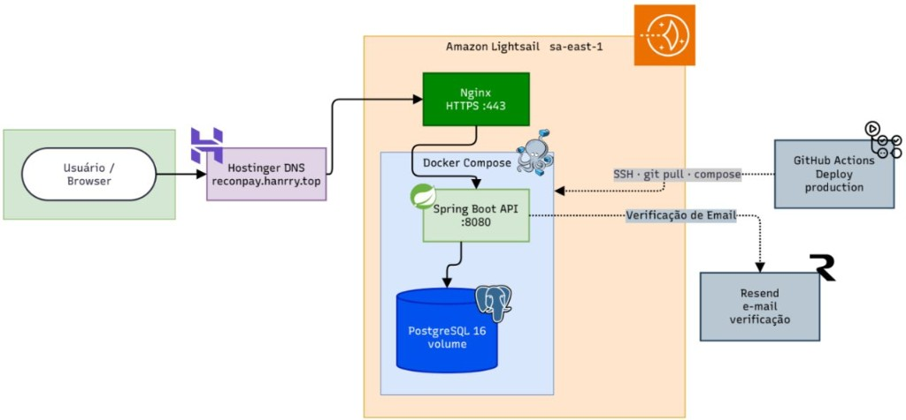

# ReconPay [](https://github.com/hanrrysantos/reconpay/actions/workflows/ci.yml) [](https://github.com/hanrrysantos/reconpay/actions/workflows/deploy-prod.yml)


Fintechs, gateways e marketplaces vendem todos os dias, mas o valor que cai na conta quase nunca é o bruto da venda. Taxa, parcela, atraso de liquidação e chargeback distorcem o líquido. Quando a conciliação vive em planilha, o erro aparece tarde, sem responsável e sem rastro para auditoria.

O **ReconPay** fecha esse ciclo numa API: cadastra o merchant e as regras de taxa, registra a transação interna com o líquido esperado, importa a liquidação externa e cruza os dois lados automaticamente, com isolamento por merchant e relatório exportável.

O ReconPay executa esse fluxo de ponta a ponta. Cada merchant é uma unidade isolada: o operador só enxerga aqueles a que recebeu acesso.

**Fluxo**

- **Merchant e taxas:** cadastro do negócio e das regras de taxa por forma de pagamento e número de parcelas.
- **Transação interna:** cada venda é registrada com o valor líquido que a empresa deveria receber, já descontando a taxa.
- **Liquidação externa:** o arquivo do adquirente ou gateway entra via CSV, é validado linha a linha e fica ligado a um lote rastreável.
- **Conciliação:** o sistema cruza os dois lados numa janela de datas, em segundo plano, e aponta o que não bate: valor, taxa, status, método, parcelas, venda sem liquidação ou liquidação sem venda.
- **Relatório:** o resultado sai em CSV para auditoria, seguro para abrir em planilha.

O time deixa de caçar desvio na planilha e passa a fechar cada janela com três respostas: o que bateu, o que a empresa vendeu e ainda não recebeu, e o que o adquirente pagou diferente do combinado. Cada execução fica gravada e exportável. Rodar de novo o mesmo período guarda o resultado antigo. O novo não apaga o anterior. O MVP está pronto para uso e já produz os dados para medir taxa de match, valor em aberto e tempo até fechar o período.

API em produção: [https://reconpay.hanrry.top](https://reconpay.hanrry.top) · [Swagger](https://reconpay.hanrry.top/swagger-ui.html) · [Health](https://reconpay.hanrry.top/actuator/health).



---

## Sumário

- [Regras de negócio](#regras-de-negócio)
- [Como executar](#como-executar)
- [Frontend](#frontend)
- [Stack](#stack)
- [Módulos](#módulos)
- [API](#api)
- [Segurança](#segurança)
- [Testes](#testes)
- [Autor](#autor)

---

## Regras de negócio

### Usuários
- E-mail único; soft delete; usuários inativos não autenticam.
- Auto-cadastro cria `OPERATOR` inativo até a verificação de e-mail. O link do e-mail abre `/verificar-email` no app, que chama `POST /api/auth/verify-email`; o link vale por `RECONPAY_VERIFICATION_TOKEN_HOURS` horas e só uma vez. `GET /api/auth/verify-email` continua atendendo os links do formato antigo.
- `POST /api/auth/resend-verification` envia um link novo e invalida os anteriores. Responde `202` sem corpo em qualquer caso, para não revelar quais e-mails têm cadastro, e só envia para conta do auto-cadastro que nunca confirmou um link e não recebeu e-mail nos últimos 60 segundos. Conta desativada pelo ADMIN não se reativa por aqui.

### Merchants
- O documento é um CNPJ de 14 dígitos com dígitos verificadores válidos; CNPJ com os 14 dígitos iguais é inválido. Inválido responde `400` `VALIDATION_ERROR` "CNPJ inválido".
- A pontuação de CNPJ (`.`, `/`, `-` e espaços) é aceita e removida: só os dígitos são gravados. Qualquer outro caractere torna o documento inválido.
- A duplicidade compara só os dígitos, contra todos os merchants gravados, inclusive desativados e documentos antigos gravados com pontuação; duplicado responde `409`.
- Soft delete; o CNPJ de um merchant desativado continua reservado. Consultas retornam apenas merchants ativos.

### Fee rules
- Uma regra ativa por combinação `(merchant, paymentMethod, installments)`.
- Índice único parcial no banco permite histórico de regras inativas.
- Taxa percentual entre 0 e 100, com até quatro casas decimais; taxa fixa não negativa.
- PIX, boleto e débito só aceitam regra com 1 parcela; criação e alteração com mais parcelas respondem `400` ("Método de pagamento <MÉTODO> não permite parcelamento").

### Transações internas
- Referência externa única por merchant, com espaços nas extremidades removidos e maiúsculas/minúsculas preservadas.
- Fee rule ativa obrigatória; `expectedNetAmount = amount - taxa percentual - taxa fixa`.
- Valores monetários aceitam até 17 dígitos inteiros e 2 casas decimais, em JSON e CSV. O líquido esperado deve ser positivo.
- PIX, boleto e débito não permitem parcelamento.
- Status inicial `APPROVED`; transições para `CANCELLED`, `REFUNDED` ou `CHARGEBACK` (sem reversão).
- Atualizações concorrentes usam versão otimista: uma alteração obsoleta recebe `409` e deve consultar o estado atual.
- Importação em lote via CSV (`POST /transactions/import`, máx. 5 MB), colunas `externalReference`, `amount`, `paymentMethod`, `installments`, `status`, `transactionDate`. O status vem do arquivo (`APPROVED`, `CANCELLED`, `REFUNDED` ou `CHARGEBACK`) e o líquido esperado é calculado como no cadastro unitário.
- O import é tudo ou nada: qualquer linha com erro (formato ou sem regra de taxa ativa) recusa o arquivo e todos os erros voltam em `details.rowErrors`; referências já cadastradas respondem `409` com `details.conflictingReferences`; datas em período travado respondem `409`. Cada import aceito gera um lote, listado em `GET /transactions/imports`.

### Liquidações externas
- Importação via CSV (máx. 5 MB) com validação linha a linha.
- Colunas esperadas: `externalReference`, `amount`, `netAmount`, `paymentMethod`, `installments`, `status`, `settlementDate`.
- Rejeita duplicidade no arquivo e no banco; `netAmount` não pode ser maior que `amount`.
- Cada importação gera um lote rastreável (`settlement_imports`).

### Conciliação
- Cruzamento por `(merchant, externalReference)` entre transações internas e liquidações externas.
- Janela obrigatória (`fromDate`, `toDate`) aplicada sobre a data da transação, limitada a `max-window-days`.
- O lado da liquidação lê a janela estendida por `settlement-lag-days`, porque uma venda no fim do período liquida no período seguinte. Liquidações cuja transação está fora da janela são ignoradas em vez de reportadas como órfãs.
- Tipos de divergência: liquidação ausente, liquidação órfã, valor bruto incorreto, taxa divergente, status inconsistente, método de pagamento divergente, parcelas divergentes. Todos são avaliados de forma independente.
- Comparação de valores aceita `amount-tolerance` (padrão `0.00`, ou seja, comparação exata).
- Cada item guarda um **snapshot** dos dois lados no momento da execução, então alterar uma transação depois não reescreve o resultado de um run passado.
- Uma janela tem no máximo um run vigente: ao concluir, o run marca o anterior como `supersededAt`.
- A execução é assíncrona: o POST devolve `202 Accepted` com o run em `PENDING` e o `Location` para acompanhar. O dispatcher consulta pendências persistidas, confirma `RUNNING` em uma transação própria antes de submeter o trabalho e devolve a `PENDING` se o executor estiver cheio. O run termina em `COMPLETED` ou `FAILED`, com mensagem pública genérica; detalhes técnicos ficam nos logs correlacionados por `runId`.
- Ao iniciar, execuções interrompidas em `RUNNING` voltam a `PENDING`. Este mecanismo pressupõe **uma instância da aplicação**; múltiplas instâncias exigem leases ou infraestrutura de fila antes de escalar.
- Enquanto houver um run `PENDING` ou `RUNNING` para a mesma janela, uma nova execução é rejeitada com `409`.
- Exportação CSV dos resultados para auditoria, escrita em streaming. Referências iniciadas por `=`, `+`, `-` ou `@` recebem prefixo `'` para impedir fórmulas em planilhas. O export de um run inexistente ou de outra empresa responde `404` `NOT_FOUND` em JSON (`StandardError`), como o `GET` do run.

Ajustáveis por `reconpay.reconciliation.*` ou pelas variáveis `RECONCILIATION_AMOUNT_TOLERANCE`, `RECONCILIATION_SETTLEMENT_LAG_DAYS`, `RECONCILIATION_MAX_WINDOW_DAYS`, `RECONCILIATION_ASYNC`, `RECONCILIATION_WORKERS` e `RECONCILIATION_QUEUE_CAPACITY`.

Tolerância, atraso e capacidade da fila não podem ser negativos; janela máxima e workers devem ser positivos. Configurações inválidas impedem a inicialização. `RECONCILIATION_ASYNC=false` executa no thread do dispatcher e mantém o POST assíncrono. Logs de auditoria de sucesso são emitidos somente após commit. JSON malformado, enum/data/UUID inválidos e multipart sem `file` retornam `400` no formato `StandardError` (`VALIDATION_ERROR`).

---

## Como executar

**Pré-requisitos:** Java 21, Docker e Docker Compose. O wrapper Maven fica em `backend/mvnw`.

### 1. Clone e configure o ambiente

```bash
git clone https://github.com/hanrrysantos/reconpay.git
cd reconpay
```

Crie um arquivo `.env` na raiz do projeto:

```env
POSTGRES_USER=postgres
POSTGRES_PASSWORD=1234
JWT_SECRET=sua-chave-secreta-com-pelo-menos-32-caracteres
JWT_EXPIRATION=86400
RESEND_API_KEY=
RECONPAY_EMAIL_FROM=ReconPay <noreply@reconpay.local>
RECONPAY_VERIFICATION_BASE_URL=http://localhost:3000
RECONPAY_VERIFICATION_TOKEN_HOURS=24
RECONPAY_CORS_ALLOWED_ORIGINS=http://localhost:3000
```

> `JWT_SECRET` é obrigatório fora dos testes, que possuem chave local exclusiva. Na **Opção A** o profile `dev` importa o `.env` da raiz ao rodar em `backend/`; na **Opção B** o Compose o injeta no container. `JWT_EXPIRATION` é expresso em segundos, com padrão `86400`, repassado pelo Compose e retornado exatamente como `expiresIn` no login. Fora de `dev`, configure também `DB_URL`, `DB_USER` e `DB_PASSWORD` (o Compose os fornece). `RECONPAY_VERIFICATION_BASE_URL` é o endereço do **frontend**, onde fica a página `/verificar-email` (padrão `http://localhost:3000`); em produção, a URL pública HTTPS do app. Sem `RESEND_API_KEY`, o envio de e-mail de verificação é apenas logado no console (útil em dev). `RECONPAY_CORS_ALLOWED_ORIGINS` lista, separadas por vírgula, as origens do frontend que podem chamar a API (por exemplo `https://reconpay.vercel.app`); ela substitui a lista padrão inteira, que tem só `localhost` nas portas 3000 e 5173, e aceita espaços em volta e barra final.

### 2. Escolha como subir a aplicação

Há duas formas. Em ambas o PostgreSQL roda na porta **5433** e a API fica em **http://localhost:8080**.

#### Opção A - Desenvolvimento local

Docker apenas para o banco; a API roda na sua máquina no profile `dev`, com os usuários de seed carregados.

```bash
docker compose up -d banco-reconpay
cd backend
SPRING_PROFILES_ACTIVE=dev ./mvnw spring-boot:run
```

Ideal para desenvolvimento, debug e execução de testes. E-mail e senha dos seeds estão em Segurança.

#### Opção B - Tudo via Docker

Sobe banco e API em containers no profile `prod`, usando o `.env` automaticamente. Não precisa instalar Java localmente, e **não há usuários de seed** — crie o primeiro ADMIN diretamente no banco.

```bash
docker compose up --build
```

Ideal para validar o projeto rapidamente ou demonstrar o ambiente completo. Em produção o mesmo Compose sobe atrás de Nginx/HTTPS; o primeiro ADMIN entra direto no banco (não há seed). Push em `backend/` na `main` dispara o CD (`.github/workflows/deploy-prod.yml`).

### 3. Acesse

| Recurso | Local | Produção |
| :--- | :--- | :--- |
| API | http://localhost:8080 | https://reconpay.hanrry.top |
| Swagger | http://localhost:8080/swagger-ui.html | https://reconpay.hanrry.top/swagger-ui.html |
| Health | http://localhost:8080/actuator/health | https://reconpay.hanrry.top/actuator/health |
| Métricas (autenticado) | http://localhost:8080/actuator/prometheus | https://reconpay.hanrry.top/actuator/prometheus |

---

## Stack

| Camada | Tecnologias |
| :--- | :--- |
| Backend | Java 21, Spring Boot 3.5, Spring Web, Data JPA, Security, Bean Validation, MapStruct, Lombok |
| Banco | PostgreSQL, Flyway, Hibernate |
| Segurança | JWT (stateless) |
| Observabilidade | Log estruturado (JSON Logstash em `prod`), auditoria, Prometheus, tracing |
| Testes | JUnit 5, Mockito, MockMvc, AssertJ, Testcontainers |
| Infra | Docker, Docker Compose, GitHub Actions (CI e CD) |

---

## Módulos

| Módulo | Responsabilidade |
| :--- | :--- |
| `auth` | Cadastro, login, verificação de e-mail, gerenciamento de usuários e grants |
| `security` | JWT, filtros, configuração de segurança e guard de acesso por merchant |
| `merchant` | Cadastro e gerenciamento de merchants |
| `feerule` | Regras de taxa por merchant |
| `transaction` | Transações internas por merchant |
| `externalsettlement` | Importação e consulta de liquidações externas |
| `reconciliation` | Motor de conciliação, divergências e relatórios CSV |
| `exception` | Tratamento global e respostas padronizadas (`StandardError`) |
| `observability` | Correlação de request, auditoria e contexto de log |
| `config` / `shared` | Configurações e utilitários compartilhados |

Estrutura interna de cada módulo:

```text
module/
├── controller/
├── dto/
├── entity/
├── mapper/
├── repository/
└── service/
```

---

## API

O contrato vivo está no Swagger, gerado a partir do código. Com a API no ar:

- UI: http://localhost:8080/swagger-ui.html ou https://reconpay.hanrry.top/swagger-ui.html
- OpenAPI: http://localhost:8080/v3/api-docs ou https://reconpay.hanrry.top/v3/api-docs

Faça login (`POST /api/auth/login`), copie o token e use **Authorize** no Swagger (`Bearer {token}`). Em `dev`, os usuários seed estão na seção Segurança. Rotas públicas: cadastro, login, verificação e reenvio do e-mail de verificação, Swagger e `/actuator/health`.

A conciliação é assíncrona: o POST devolve `202 Accepted` e o `Location` aponta para o GET da execução.

### Endpoints usados pelo dashboard

Todos ficam sob `/api/merchants/{merchantId}` e seguem as mesmas regras de acesso (OPERATOR com grant ou ADMIN).

| Endpoint | O que devolve |
| :--- | :--- |
| `GET /periods/summary?fromDate&toDate` | Resumo do run vigente da janela: bruto, líquido esperado, taxas, taxa acima do contrato, total que caiu no banco, abertas por tipo, um registro por dia da janela e os comparativos (taxa do run anterior, bruto do período anterior). Dinheiro com duas casas. `400` janela inválida, `404` sem run vigente, `409` run em andamento. |
| `GET /reconciliations/{runId}/items?discrepancyStatus=OPEN&sort=absDifference,desc` | Items com ao menos uma divergência no status pedido, da maior diferença absoluta (`settlementNetAmount − expectedNetAmount`, lado ausente vale zero) para a menor. Combina com `result` e `discrepancyType`; status inválido responde `400`. |
| `GET /reconciliations?fromDate&toDate` | Runs da janela exata, mais recente primeiro; sem os dois parâmetros, todos os runs do merchant. Só um deles responde `400`. |
| `GET /reconciliations/{runId}` | O run ganha `processedItems`: nulo em `PENDING`, cresce durante `RUNNING` sem passar de `totalItems` e fica igual a ele em `COMPLETED`. |
| `GET /bank-statements/imports` | Imports de extrato paginados, mais recente primeiro (`id`, `fileName`, `totalRows`, `createdAt`). |

Nas listagens paginadas, `sort` por um campo que não existe responde `400 VALIDATION_ERROR`.

---

## Segurança

Autenticação JWT, sem sessão no servidor.

| Papel | O que faz |
| :--- | :--- |
| **ADMIN** | Usuários, grants e ativação de contas que ele criou. Enxerga todos os merchants. |
| **OPERATOR** | Fluxo operacional (merchant, taxas, transações, import, conciliação) só nos merchants concedidos. |

Quem cria um merchant recebe acesso a ele automaticamente. O auto-cadastro gera `OPERATOR` inativo até o link de e-mail. Contas criadas pelo ADMIN podem ser ativadas por ele.

Em `dev` e `test` existem usuários seed (nunca em produção):

| Role | E-mail | Senha |
| :--- | :--- | :--- |
| ADMIN | `admin@reconpay.local` | `DevAdmin@2026` |
| OPERATOR | `analyst@reconpay.local` | `DevAnalyst@2026` |

CORS libera, em `/api/**`, as origens de `reconpay.cors.allowed-origins`: por padrão `http://localhost:3000` (Next.js) e `http://localhost:5173`, com as variantes `127.0.0.1`. Em produção, defina `RECONPAY_CORS_ALLOWED_ORIGINS` com o endereço do frontend; o Compose repassa a variável ao container.

---

## Frontend

O aplicativo Next.js fica em [`frontend/`](frontend/README.md). Com a API em `http://localhost:8080`, execute `cd frontend && corepack pnpm install && corepack pnpm dev` e acesse `http://localhost:3000`. A página inicial `/` é a apresentação pública do produto, com animações ligadas ao scroll. Em `/register` o visitante cria a conta e vê as regras da senha marcadas enquanto digita; o link do e-mail abre `/verificar-email`, que ativa a conta ou, com o link vencido ou já usado, pede um link novo. O dashboard em `/painel` lê o fechamento da janela, resolve divergências, roda a conciliação, trava e exporta, sempre com dados da API. Em `/empresas` o usuário lista, cadastra, renomeia e desativa merchants. Em `/importacoes` envia os CSVs de transações, liquidação (layout `RECONPAY`) e extrato da empresa selecionada, vê todos os erros por linha de um arquivo recusado e os lotes já importados. Em `/transacoes` lista as transações da empresa por período, status e método, cadastra uma venda avulsa e muda o status de uma transação aprovada para cancelada, estornada ou chargeback, com confirmação por ser irreversível. Em `/conciliacoes` vê o histórico de runs da empresa (com progresso, selo de substituído e falha, filtro por mês) e dispara uma conciliação de qualquer janela de até 366 dias. Em `/conciliacoes/[runId]` vê os itens de um run, filtra por resultado e tipo de divergência e exporta o CSV de um run concluído. Em `/divergencias` vê as divergências do run vigente de uma janela, filtradas por status e tipo, e as resolve (aceitar, ajustar, baixar) ou reabre pela gaveta do dashboard, com o histórico de cada uma. Em `/fechamento` vê todos os períodos da empresa com o status de fechamento (travado, aberto, em andamento, sem conciliação concluída), a taxa de match, o valor em aberto e a duração da trava, e trava, destrava ou exporta o CSV de cada um.

---

## Testes

| Tipo | Ferramentas | Escopo |
| :--- | :--- | :--- |
| **Unitário** | JUnit 5, Mockito, MockMvc | Services, parsers, mappers e controllers |
| **Integração** | Testcontainers (PostgreSQL), MockMvc | Fluxos de ponta a ponta com banco real (precisa de Docker) |

```bash
cd backend && ./mvnw verify
```

Isso roda os testes e falha se a cobertura ficar abaixo de 85% das linhas ou 75% dos ramos. Na GitHub Actions, push e PR para `main` disparam só o que a mudança pede: `verify` quando `backend/` ou o workflow mudam; testes, typecheck, build e `pnpm audit` (severidade alta ou crítica) quando `frontend/` ou o workflow mudam; a imagem da API, com cache de camadas, quando `backend/`, o Compose ou o workflow mudam. O scan OWASP lê os JARs de runtime que o Maven resolve, reprova CVSS ≥ 7, e corre quando `backend/pom.xml` ou o workflow mudam, no disparo manual e toda segunda-feira. Push em `backend/`, no Compose ou no workflow de deploy dispara o CD para a VPS (`.github/workflows/deploy-prod.yml`).

---

## Autor

**Hanrry Santos**

[](https://www.linkedin.com/in/hanrrysantos)
[](https://github.com/hanrrysantos)

---
