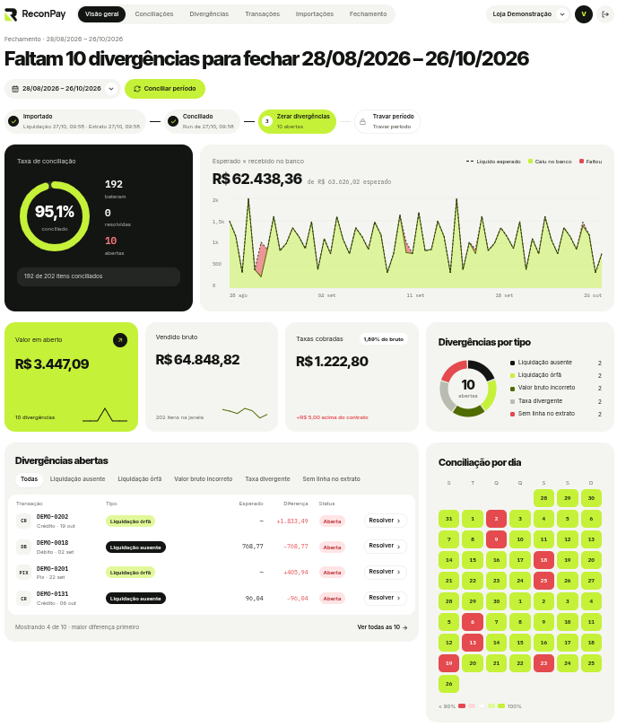
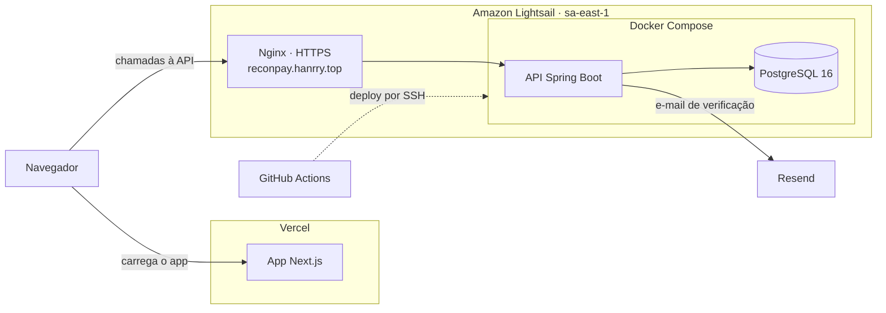
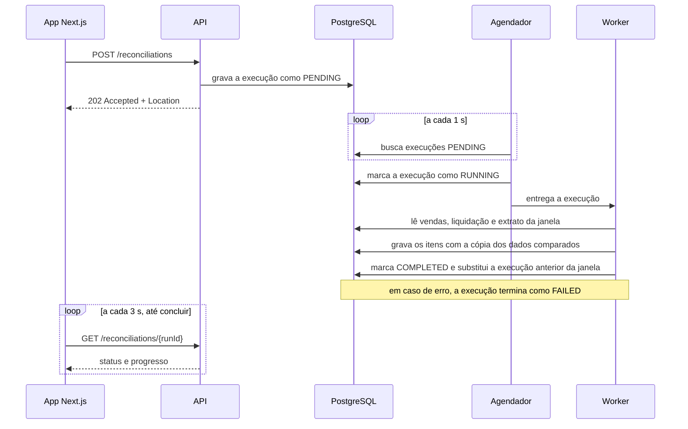

# ReconPay [](https://github.com/hanrrysantos/reconpay/actions/workflows/ci.yml) [](https://github.com/hanrrysantos/reconpay/actions/workflows/deploy-prod.yml)

[Backend](backend/README.md) · [Frontend](frontend/README.md)

## O problema

Empresas que vendem por cartão, Pix ou boleto recebem o dinheiro das vendas pelo adquirente, com taxas descontadas e prazos que variam conforme a forma de pagamento. Para garantir que o valor recebido está correto, é preciso comparar cada venda com o repasse do adquirente e com o crédito no extrato bancário. Quando essa comparação é feita em planilha, diferenças de taxa e repasses que não chegaram são descobertos com atraso.

## O que o ReconPay resolve

O ReconPay automatiza essa comparação. A empresa importa as vendas, a liquidação do adquirente e o extrato bancário, e o sistema cruza os três em duas fases: primeiro cada venda com a liquidação correspondente, depois cada liquidação com o crédito no banco. As diferenças encontradas viram divergências, que o time resolve com registro de quem decidiu e quando. Sem divergências abertas, o período é travado e o relatório pode ser exportado.

<p align="center">
  
</p>

## Acesso

| Link | O que é |
| :--- | :--- |
| [Aplicação](https://reconpay.vercel.app) | Interface web do ReconPay. O botão "Ver demonstração" cria uma conta temporária com 60 dias de dados, sem cadastro |
| [Documentação da API](https://reconpay.hanrry.top/swagger-ui.html) | Swagger com todos os endpoints, que permite testar as chamadas |
| [Status da API](https://reconpay.hanrry.top/actuator/health) | Indica se a API está no ar |

## Arquitetura

### Infraestrutura



### Conciliação



## Funcionalidades

- **Empresas e regras de taxa:** cada empresa é identificada pelo CNPJ e tem uma taxa por forma de pagamento e número de parcelas.
- **Vendas:** registradas pelo formulário ou por CSV. O valor líquido esperado é calculado pela regra de taxa.
- **Importação por CSV:** vendas, liquidação do adquirente e extrato bancário. Um arquivo com qualquer linha inválida é recusado inteiro, e a resposta lista o erro de cada linha.
- **Conciliação:** compara vendas, liquidação e extrato de um período e aponta cada diferença, como taxa acima da regra, venda sem liquidação ou crédito que não chegou ao banco. Uma nova conciliação do mesmo período não apaga a anterior.
- **Painel de fechamento:** taxa de conciliação, valor em aberto, esperado × recebido no banco e divergências por tipo e por dia.
- **Resolução de divergências:** cada divergência pode ser aceita, ajustada com um lançamento de correção, baixada ou reaberta. Cada mudança registra autor, data e observação.
- **Fechamento de período:** um período sem divergências abertas pode ser travado. Travado, ele não aceita importações nem alterações.
- **Relatório em CSV:** exporta o resultado de uma conciliação para auditoria.
- **Usuários e permissões:** o administrador acessa todas as empresas e gerencia os usuários. O operador acessa só as empresas liberadas para ele.
- **Conta de demonstração:** criada com um clique, já com dados, e expira em 24 horas.

## Stack

### Backend

- Java 21 + Spring Boot 3.5
- Spring Security com JWT, sem sessão no servidor, e verificação de acesso em todas as rotas de uma empresa
- Spring Data JPA com `ddl-auto=validate` e o schema versionado em migrations do Flyway
- PostgreSQL 16 com `NUMERIC(19,2)` para valores em dinheiro e versão otimista nas transações
- MapStruct para converter entidades em DTOs
- Springdoc OpenAPI para gerar o Swagger a partir do código
- Micrometer para métricas no formato Prometheus e tracing com OpenTelemetry; logs em JSON em produção
- Resend, chamado por HTTP, para o e-mail de verificação de cadastro

### Frontend

- Next.js 16 + React 19 + TypeScript
- Tailwind CSS 4 com o tema "Lima" (verde-limão como cor de destaque) e as fontes Inter, Inter Tight e Manrope
- TanStack Query para cache, atualização das telas após cada ação e acompanhamento das conciliações em andamento
- `lossless-json` para que valores em dinheiro nunca passem por `number` no navegador
- Gráficos em SVG próprio, sem biblioteca

### Infraestrutura

- Docker com build em dois estágios (Maven para compilar, JRE Alpine para rodar) e usuário sem privilégios
- Docker Compose com a API e o PostgreSQL, limite de 1 GB de memória e reinício automático
- Nginx como proxy reverso com HTTPS
- Amazon Lightsail (São Paulo) para a API e Vercel para o frontend
- GitHub Actions para CI e deploy da API por SSH

## Como rodar

Pré-requisitos: Docker e Node.js 24.

**1. Clone o repositório**

```bash
git clone https://github.com/hanrrysantos/reconpay.git
cd reconpay
```

**2. Crie o `.env` a partir do exemplo**

```bash
cp .env.example .env
```

**3. Suba o banco e a API**

```bash
docker compose up -d --build
```

A primeira subida leva alguns minutos, porque a API é compilada dentro da imagem. Depois, ela fica em `http://localhost:8080`, com o Swagger em `http://localhost:8080/swagger-ui.html`.

**4. Suba o frontend**

```bash
cd frontend
corepack pnpm install
corepack pnpm dev
```

**5. Acesse**

Abra `http://localhost:3000` e clique em "Ver demonstração" para entrar com uma conta já preenchida com dados.

## Qualidade

- **Testes do backend:** unitários com JUnit 5 e Mockito, e de integração com PostgreSQL real via Testcontainers.
- **Testes do frontend:** Vitest e Testing Library.
- **Cobertura mínima:** o build do backend falha com menos de 85% das linhas ou 75% dos branches cobertos, medidos pelo JaCoCo.
- **CI:** cada push e pull request na `main` roda as verificações da parte alterada: testes do backend, testes, typecheck e build do frontend, ou build da imagem Docker.
- **Dependências:** `pnpm audit` no frontend e scan OWASP no backend, que reprova vulnerabilidades com nota CVSS 7 ou mais. O scan também roda toda segunda-feira.
- **Deploy:** cada push no backend da `main` atualiza a API em produção, e o deploy só termina quando ela responde no health check.

## Autor

**Hanrry Santos** · [LinkedIn](https://www.linkedin.com/in/hanrrysantos) · [GitHub](https://github.com/hanrrysantos)
